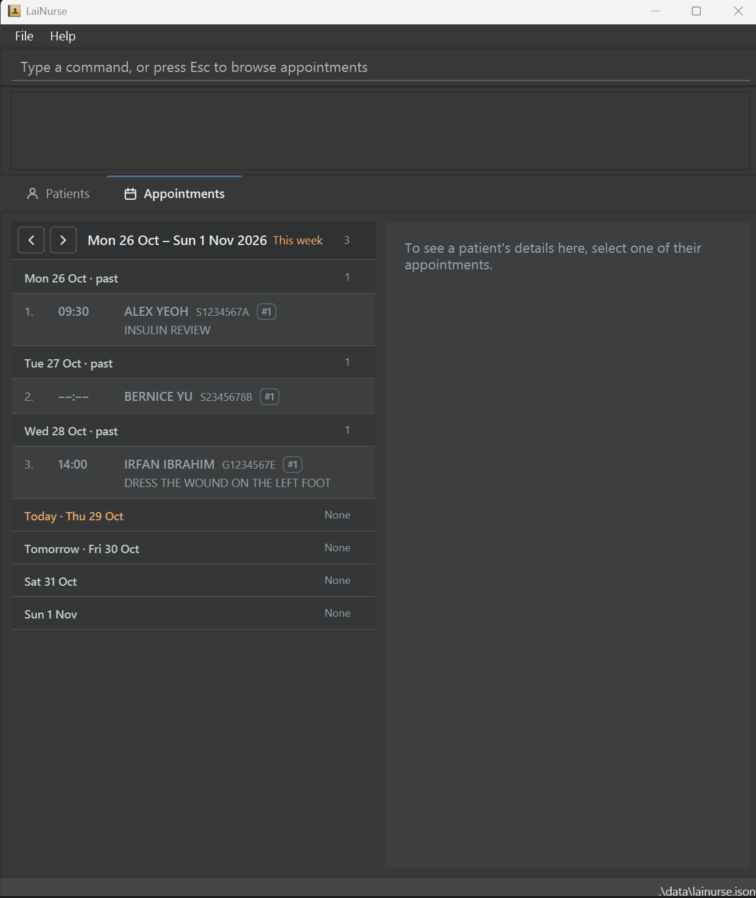

# LaiNurse

**LaiNurse** is a desktop app that gives home nurses fast access to patient and appointment details for home visits. You type commands in a Command Line Interface (CLI), and a GUI shows the results.

With LaiNurse, you can:

* keep each patient's ID, contact details and medical history in one place
* give each patient any number of appointments, and see whom you visit on a date or in a date range
* find patients by part of their name, ID, phone number, address, medical history or notes
* check the format of any command without leaving the keyboard

To try LaiNurse, download the latest `lainurse.jar` from [Releases](https://github.com/AY2627S1-CS2103T-F08-2/tp/releases), and follow the [Quick start](https://ay2627s1-cs2103t-f08-2.github.io/tp/UserGuide.html#quick-start) in the User Guide.

For the detailed documentation of this project, see the **[LaiNurse product website](https://ay2627s1-cs2103t-f08-2.github.io/tp/)**, which has the [User Guide](https://ay2627s1-cs2103t-f08-2.github.io/tp/UserGuide.html) and the [Developer Guide](https://ay2627s1-cs2103t-f08-2.github.io/tp/DeveloperGuide.html).

This project is based on the AddressBook-Level3 project created by the [SE-EDU initiative](https://se-education.org).
