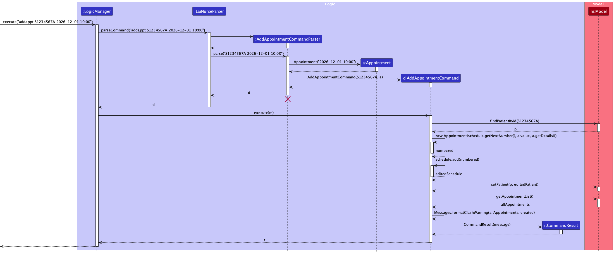
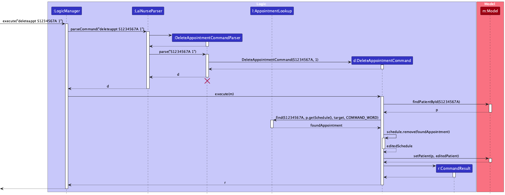
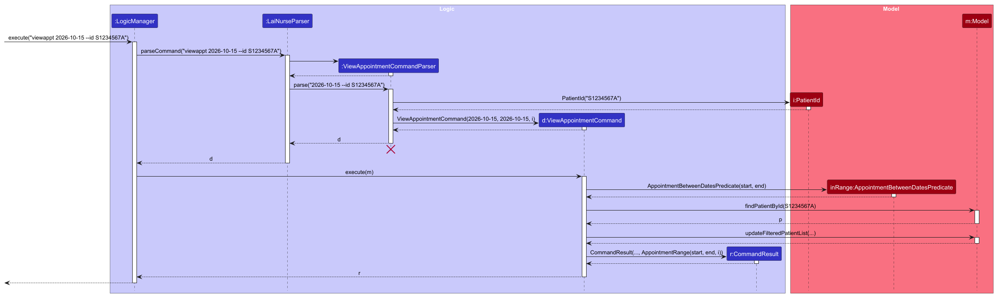
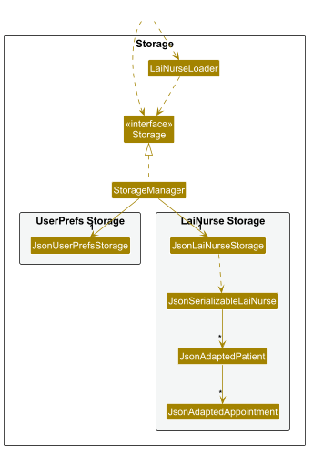
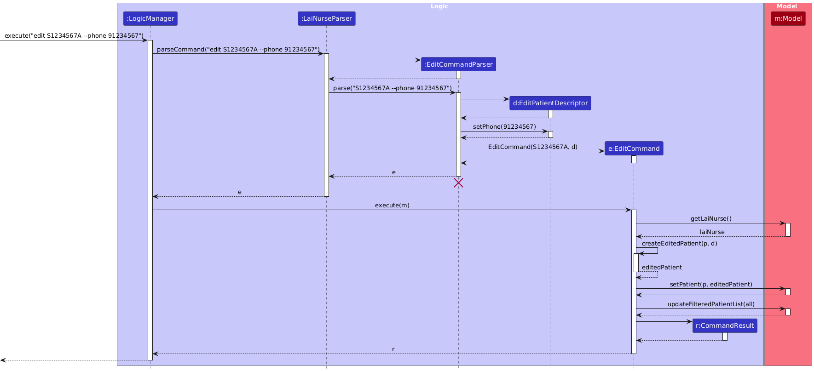
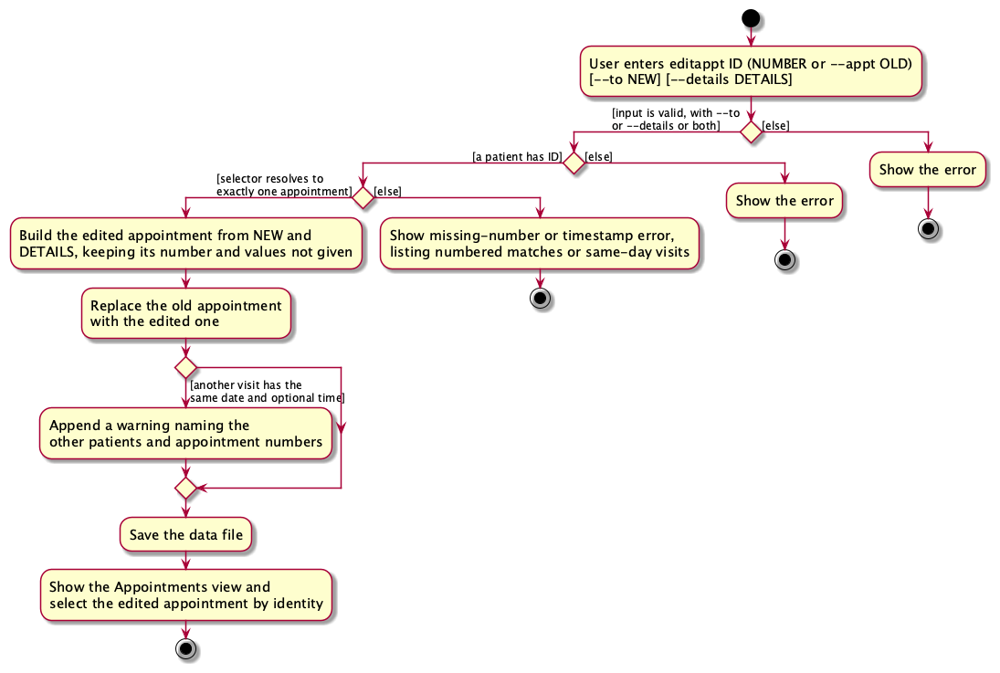
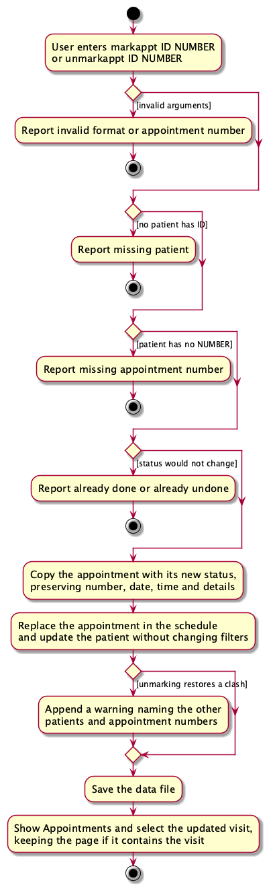

* Table of Contents
{:toc}

--------------------------------------------------------------------------------------------------------------------

## **Acknowledgements**

* Codebase adapted from [AddressBook-Level3 (AB3)](https://github.com/se-edu/addressbook-level3) developed by the SE-EDU initiative.
* UI components and controls utilize native [JavaFX 17+](https://openjfx.io/) libraries.

* AI Use Declaration from Qin Fangzheng: "As my career path is not related to software engineering, I choose AI-5/AI-6 as my AI use level, where I get Codex to do the tasks, and then I myself review the results, including feature behavior and partial code."

* AI Use Declaration from Jaydon: "I used Codex and OpenCode to review and generate code.
  Based on the given levels of AI use in coding tasks, this ranges between AI-2 and AI-6".

* AI Use Declaration from Yuhao: "I used Claude Code to write code, tests and documentation, and I review and test the results. AI levels between AI-5 and AI-6"

* AI Use Declaration from Yong Kang: "I used Gemini to write and review code, tests and documentation. No automation is done and I go back and forth consistently with AI to ensure I am still largely in charge of the process. AI levels between AI-1 and AI-5."

* AI Use Declaration from Darren: "I used Claude Code to write code, tests and documentation, and I review and test the results. The level ranges between AI-2 and AI-6" 

--------------------------------------------------------------------------------------------------------------------

## **Setting up, getting started**

Refer to the guide [_Setting up and getting started_](SettingUp.md).

--------------------------------------------------------------------------------------------------------------------

## **Design**

:bulb: **Tip:** The `.puml` files used to create diagrams are in `docs/diagrams`. Refer to the [_PlantUML
Tutorial_ at se-edu/guides](https://se-education.org/guides/tutorials/plantUml.html) to learn how to create and edit
diagrams.

### Architecture

The ***Architecture Diagram*** given above explains the high-level design of the App.

The following provides a quick overview of the main components and their interactions.

**Main components of the architecture**

**`Main`** (consisting of classes [
`Main`](https://github.com/AY2627S1-CS2103T-F08-2/tp/tree/master/src/main/java/seedu/address/Main.java) and [
`MainApp`](https://github.com/AY2627S1-CS2103T-F08-2/tp/tree/master/src/main/java/seedu/address/MainApp.java)) is in
charge of the app launch and shut down.

* At app launch, it initializes the other components in the correct sequence, and connects them up with each other.
* At shut down, it shuts down the other components and invokes cleanup methods where necessary.

The bulk of the app's work is done by the following four components:

* [**`UI`**](#ui-component): The UI of the App.
* [**`Logic`**](#logic-component): The command executor.
* [**`Model`**](#model-component): Holds the data of the App in memory.
* [**`Storage`**](#storage-component): Reads data from, and writes data to, the hard disk.

[**`Commons`**](#common-classes) represents a collection of classes used by multiple other components.

**How the architecture components interact with each other**

The *Sequence Diagram* below shows how the components interact with each other for the scenario where the user issues
the command `delete 1`.

Each of the four main components (also shown in the diagram above),

* defines its *API* in an `interface` with the same name as the Component.
* provides its functionality through a concrete `{Component Name}Manager` class that implements the corresponding API
  interface.

For example, the `Logic` component defines its API in `Logic.java` and implements it in `LogicManager.java`. Other
components interact with a component through its interface rather than its concrete class, preventing them from coupling
to that component's implementation, as illustrated in the following partial class diagram.

The sections below give more details of each component.

### UI component

The **API** of this component is specified in [
`Ui.java`](https://github.com/AY2627S1-CS2103T-F08-2/tp/tree/master/src/main/java/seedu/address/ui/Ui.java)

The UI consists of a `MainWindow` and its parts, such as `CommandBox`, `ResultDisplay`, `PatientListPanel`,
`AppointmentListPanel`, two `PatientDetailPanel`s, and `StatusBarFooter`. All of these, including `MainWindow`, inherit
from the abstract `UiPart` class, which captures common behavior among classes that represent visible GUI parts.

`MainWindow` shows one of two views at a time, and a tab for each above them. The patient view holds
`PatientListPanel` and a `PatientDetailPanel`. The appointment view holds `AppointmentListPanel` and a second
`PatientDetailPanel`, so that each view keeps its own state while it is hidden. A `CommandResult` can name the view to
show (see [Patient and appointment views](#patient-and-appointment-views)), and clicking a tab, or Left and Right with the
focus on the tabs, switch the view without running a command.

In each view, `MainWindow#shareWidth` splits the width between the list and the details, so that both grow and shrink
together as the window is resized. Up to a window about 1,000 pixels wide, each takes half. In a wider window, the
list's share falls steadily, to 28% in a window 1,920 pixels wide, a full HD screen, and stays there in a wider one, so
that the details take most of the extra room. The list itself never gets narrower as the window gets wider. The window
can be no narrower than both at their minimum widths. In a narrow list header, the note, such as `This week`, and the
count give up their room before the dates do. With room, `PatientDetailPanel` shows each appointment's date, time and
details side by side, with the same widths in every row, so that they line up. In narrow details, it puts the details
under the time, shrinks the dates of all rows together and lets the times wrap, so that the times stay in line and no
row is wider than the panel.

`PatientListPanel` shows each patient in the filtered list as a `PatientRow`, with their next appointment, and its
`PatientDetailPanel` shows all the details of one patient. Each list cell builds one `PatientRow` and shows each of its
patients in it, since loading the row's FXML for every patient that scrolls into view makes scrolling stutter.
The panel also takes the list of all appointments, so that a row shows its next appointment in red if it clashes, and
refreshes its rows when any appointment changes, since a change to one patient can make another's appointment clash.
`PinMark#setColor` can color a row's pin, such as red, for settings that may change what a mark means (#216).
Above the rows, a header says whether the list is filtered,
and how many patients it shows. The panel takes both the filtered list and the list of all patients, and
`Logic#isPatientListFiltered`, which is true while the list has a filter, such as after `find`. It counts the list as
filtered then, even if the filter hides no one, such as `6 of 6`, so that the header shows what the first Esc removes,
and the Esc does not seem to do nothing. Both
lists end their header where their rows' last column ends, with `ListHeaders#alignEndWithRows`: the header's end
padding is the list's inset, plus the width of its vertical scroll bar, plus a row's end padding, which is 12 pixels
in both lists. While a list shows no scroll bar, each of its cells leaves the scroll bar's width empty at its end
instead, with `ListHeaders#cellPadding`. So the count at the end of the header lines up with the rows' next
appointments, or the day headings' counts, ends in the same place in both lists, and keeps its end in place as its
text changes or the scroll bar comes and goes. When a
`CommandResult` names a patient to view, as the result of `view` does, `MainWindow` tells that `PatientDetailPanel` to
show the patient. After every command, `MainWindow` highlights the shown patient's row in `PatientListPanel`, or no row if
that patient is not in the displayed list. `PatientDetailPanel` finds the patient by ID in the list of all patients from
`Logic#getPatientList()`, and listens to that list. So it shows a patient's new details after an edit, and goes back to
its starting message after the patient is deleted, whatever the filter on the displayed list is.

An appointment has passed once its time today has gone by, or once its day is over if it has no time.
`AppointmentFormatter#hasPassed` holds this rule, and the three places that show appointments use it:

* A patient's row filters out done visits, then shows their first appointment that has not passed, from
  `AppointmentFormatter#findFirstNotPassed`. Completion does not affect the other date-based rules below.
* `DetailAppointments` picks the appointments that the details list: every one that has not passed, and the latest ten
  that have, plus a marked older one.
* The appointment list greys out the appointments that have passed.

Each of these decides what has passed, and which day is today, when it is drawn. So that they stay right while the
window is left open, `MinuteClock` reads the clock every few seconds and tells `MainWindow` when the minute changes.
`MainWindow` then asks `AppointmentFormatter#hasChangedBetween` whether an appointment has passed, or a new day has
begun, since the minute before. Only then does it refresh both lists and both details panels, which keep their
selection. Reading the clock every few seconds, rather than once a minute, also catches up within seconds after the
computer wakes from sleep.

`AppointmentListPanel` shows the appointments of `Logic#getAppointmentList()`, which holds every appointment of every
patient, on one of two kinds of page. The weekly view shows one `AppointmentWeek`, from Monday to Sunday, which a plain
`viewappt` shows for this week. After `viewappt` with a date, a range or `--id`, the panel shows only the appointments
in the command's range, on one page, and hides the week's arrow buttons; if the range carries a patient ID, only that
patient's appointments. `AppointmentPage#ofWeek` and
`AppointmentPage#ofRange` turn the appointments into rows: a heading for each day
of the week, or for each day in the range that has an appointment, followed by that day's appointments, numbered down
the page. The panel draws each heading itself, and each appointment as an `AppointmentRow`. As in the patient list, each list cell builds one heading and one row, and shows each of its rows in them. An appointment with no time comes first in its day, except today, where it comes after the appointments that
have passed, right above the next one. A page is built as at the time given to it, so the page and the appointment that
it selects first agree, and unit tests can fix the time. While a range is shown, the panel keeps the week of the weekly
view, so that Esc goes back to it. The panel listens to the appointment list and rebuilds the page after a change,
keeping the selected appointment if it is still there. Only appointment rows can be selected, so the panel handles Up,
Down, Home, End, Left and Right itself, with the moves that `AppointmentPage` finds, and headings ignore the mouse. When
the selection changes, the panel tells `MainWindow`, which shows the appointment's patient in the second
`PatientDetailPanel` with that appointment marked.

`DarkTheme.css` gives each highlight colour one meaning, as two named colours at its top: orange for urgency, which is
whatever is today, and a blue for selection, which is the keyboard focus and the selected tab, row and
appointment. So the marked appointment in the details is orange only if it is today.

Whenever the text in the command box changes, `CommandBox` asks `Logic#getCompletions(String)` for the ways to finish
the word that the text ends with. Each is a `Completion`: the whole command after the completion, and the word that it
fills in. `CommandBox` passes the words to `StatusBarFooter#showCompletions`, which shows them after a **Tab** key cap at
the left end of the status bar, while the command box has the focus and at least one completion would change the text.
It shows at most the first five words, then the number of the others, such as `+19 more`, so that a long list of
patient IDs does not fill the status bar.
Tab replaces the text with the first completion, and each further Tab with the next. While Tab goes through them,
`CommandBox` keeps the list, so the status bar keeps showing it. After the only completion, `CommandBox` asks for the
completions of the new text at once, so that `addap` gives `addappt`, and the status bar then shows the patient IDs
that the next Tab goes through. With nothing to finish, Tab does nothing, so it never moves the focus out of the
command box. On Tab, and when the command box gets the focus back, `CommandBox` asks again unless Tab is going through a
list, as the patients may have changed since the user typed. The hint is in the status bar, not in a pop-up under the
command box, so that it never covers the result of the last command. The team chose this design from three mockups.

`TabCompleter` in the `Logic` component holds the rules, so `CommandBox` needs no knowledge of the command formats. It
completes the first word to the longer command words that start with it, the word after `help` to what `help` can
explain, a word that starts with `-` to the command's options that are not typed yet, and the word after `--id` in
`viewappt` to a patient ID. It does not complete the ID after `--id` in `find`, which searches for any part of an ID,
or in `add`, which takes a new one. The word being completed matches ignoring case, but command words, options and
`help` topics are completed in lowercase, the only case that the parsers accept. The words before it are matched
exactly, as the parsers match them, so `EDIT S1234567A --PH` has nothing to complete. Its table of each command's options must be updated with the parser when a
command gets a new option. Otherwise it passes the text to `IdCompleter`, which completes the ID that a command takes
first. `view` and `delete` take only an ID, so the ID must end the command. `edit`, `addappt`, `editappt`,
`deleteappt`, `markappt` and `unmarkappt` take the ID first, so `IdCompleter` completes the word after the command word
and keeps later options or appointment numbers. A whole command word that no other command word starts with, such as
`addappt`, also goes to `IdCompleter`, which adds a space and the ID.
`CommandBox` also keeps a `CommandHistory` of the commands entered since the app
started, which the Up and Down keys go through. The history is kept only in the UI, because no command needs it.

The keyboard focus is in one of three areas, given by `FocusArea`: the command box, and in the view that is shown, the
view tabs or the list. The details beside the list are not an area, so the keyboard never moves the focus there. In the
view, Tab moves between the tabs and the list, as `FocusArea#afterTab` gives. Up and Down move between them too: each
list calls back to `MainWindow` when Up is pressed at its first row, and `MainWindow` handles Down on the tabs. Up on
the tabs does nothing: `MainWindow` consumes it, so that JavaFX does not move the focus to another node. In both lists,
Ctrl+Up and Ctrl+Down (Cmd on macOS, as given by `KeyEvent#isShortcutDown`) select the first and last row. The tabs
take the focus only from the keyboard, so a click on a tab does not move the focus. If a tab has the focus when the view
changes, `MainWindow` moves the focus to the tab of the view being shown.

Esc in the command box calls back to `MainWindow`, which moves the focus to the list, or to the tabs if the patient list
is empty, and leaves the typed text in place. Outside the command box, `MainWindow` handles keys with event filters on
the window, which see each key before the focused part does. `BrowseKeys` decides what Enter, Esc, Tab, Shift+Up,
Shift+Down and typed text do there:

* Enter, and any printable character, move the focus back to the command box. A typed character is added to the text
  there.
* Esc resets the view by one step, and keeps the selected entry so that it is seen among the rest. In the patient
  view, `MainWindow#resetView` calls `Logic#resetPatientList`, which removes the filter of the patient list, such as
  that of `find`, and keeps its scope. With no filter, it goes back to the default scope, as `view` does. It runs no
  command. So nothing is saved, the status message stays, and no `Navigation` selects the first patient;
  `resetView` only selects again, in the longer list, the patient whose details are shown. (Running `view` itself would
  show the first patient's details and then the earlier patient's again.) In the appointment view,
  `AppointmentListPanel#reset` removes the filter of `viewappt`: from a page, it goes back to the weekly view of the
  selected appointment's week, or of this week if none is selected, with the default scope, unless the selected
  appointment is an archived patient's. In the weekly view, it goes back to the default scope. It keeps the selection
  if it can. See [Archiving patients](#archiving-patients).
* Tab moves the focus between the tabs and the list. The appointment list always takes the focus, so that Left and
  Right can leave an empty week.
* Shift+Up and Shift+Down scroll the details beside the list, with `PatientDetailPanel#scroll`, as the details never
  take the focus.
* Shift+Tab does nothing, also in the command box. `MainWindow` consumes it, or JavaFX would move the focus to another
  node.

The menu bar must not take these keys. JavaFX's `MenuBar` selects a menu that the mouse is over, in a focused window,
and while a menu is selected, a key filter that it adds to the scene takes Left and Right to move between the menus.
That filter runs before the filters on the tabs and the lists, and the menu stays selected after the mouse has left,
until a click outside the menu bar. So `MainWindow#ignoreHoverOfClosedMenus` stops the mouse-entered events of the
menus while no menu is open. As JavaFX then sets no `:hover`, it gives the menu under the mouse the `hovered`
pseudo-class, which `DarkTheme.css` styles as Modena styles `:hover`. A click still opens a menu, and an open menu
still follows the mouse to the next one.

`FocusArea`, `BrowseKeys`, `AppointmentWeek`, `AppointmentPage`, `DetailAppointments` and `AppointmentFormatter` hold
no JavaFX nodes, so unit tests cover these rules, and the UI parts only connect them to JavaFX.

The selected patient in the list is always the patient whose details are shown. When the focus moves to the list and
no row is selected, `MainWindow` selects the first patient and shows them. `PatientListPanel` shows the details of a
newly selected patient only while the user holds a key that moves the selection, such as Up or Down, or clicks a row.
This is because a command that filters or removes rows also moves the selection in the `ListView`, and that must not
change the shown patient. After each command, `MainWindow` selects the shown patient's row again.

The `UI` component uses the JavaFX UI framework. The layouts of these UI parts are defined in matching `.fxml` files in
`src/main/resources/view`. For example, [
`MainWindow.fxml`](https://github.com/AY2627S1-CS2103T-F08-2/tp/tree/master/src/main/resources/view/MainWindow.fxml)
specifies the layout of [
`MainWindow`](https://github.com/AY2627S1-CS2103T-F08-2/tp/tree/master/src/main/java/seedu/address/ui/MainWindow.java).

The `UI` component,

* executes user commands using the `Logic` component.
* listens for changes to `Model` data so that the UI can be updated with the modified data.
* keeps a reference to the `Logic` component, because the `UI` relies on the `Logic` to execute commands.
* depends on some classes in the `Model` component because it displays `Patient` objects from the model.

### Logic component

**API** : [
`Logic.java`](https://github.com/AY2627S1-CS2103T-F08-2/tp/tree/master/src/main/java/seedu/address/logic/Logic.java)

Here's a (partial) class diagram of the `Logic` component:

The sequence diagram below illustrates the interactions within the `Logic` component, taking `execute("delete
S1234567A")` API
call as an example.

:information_source: **Note:** The lifeline for `DeleteCommandParser` should end at the destroy marker (X), but due to a limitation of PlantUML, it continues to the end of the diagram.

The appointment commands follow the same shape. The diagram below shows the `addappt` command, which uses
`Model#findPatientById()` to find the patient among all patients and adds the appointment to their schedule.

The `deleteappt` command also follows this shape, up to the lookup: it finds the matching appointment with
`AppointmentLookup#find()` and removes it from the patient's schedule.

The `viewappt` command follows the same shape: it builds an `AppointmentBetweenDatesPredicate` from the date
range and filters the patient list with it (`--id` narrows both the appointments and the patient list to one
patient), then returns a `CommandResult` carrying the range for the appointment view.

How the `Logic` component works:

1. When `Logic` is called upon to execute a command, the command is passed to a `LaiNurseParser` object, which in
   turn creates a parser that matches the command (e.g., `DeleteCommandParser`) and uses it to parse the command.
1. This results in a `Command` object (more precisely, an object of one of its subclasses e.g., `DeleteCommand`) which
   is executed by the `LogicManager`.
1. The command can communicate with the `Model` when it is executed (e.g. to delete a patient). 
   Note that although this is shown as a single step in the diagram above for simplicity, the code can require several
   interactions between the command object and the `Model` to complete the operation.
1. The result of the command execution is encapsulated as a `CommandResult` object which is returned from `Logic`.

Here are the other classes in `Logic` (omitted from the class diagram above) that are used for parsing a user command:

How the parsing works:

* When called upon to parse a user command, the `LaiNurseParser` class creates an `XYZCommandParser` (`XYZ` is a
  placeholder for the specific command name, e.g., `AddCommandParser`). The parser uses the other classes shown above to
  parse the user command and create an `XYZCommand` object (e.g., `AddCommand`). The `LaiNurseParser` returns that
  object as a `Command` object.
* All `XYZCommandParser` classes, such as `AddCommandParser` and `DeleteCommandParser`, implement the `Parser` interface
  so they can be treated similarly where appropriate, for example during testing.

### Model component

**API** : [
`Model.java`](https://github.com/AY2627S1-CS2103T-F08-2/tp/tree/master/src/main/java/seedu/address/model/Model.java)

The `Model` component,

* stores the LaiNurse data i.e., all `Patient` objects (which are contained in a `UniquePatientList` object).
* stores the `Patient` objects selected by the current scope and filter, such as search results, in a separate
  _filtered_ list. The scope, a `PatientScope`, chooses whether archived patients show, and the filter chooses among
  the patients in the scope. It exposes this list as an unmodifiable `ObservableList<Patient>` that the UI can observe
  and bind to, so the UI updates when the list changes. The filtered list has archived patients last, and is otherwise
  in name order: `ModelManager` keeps a `SortedList` with `PatientNameComparator`, which compares by name ignoring case
  and then by patient ID, between the patient list and the filter. A second `SortedList` over the filter orders the
  results when a command gives a comparator, such as by the number of fields matched by `find`, still with archived
  patients last. The stored patient order is unchanged.
* keeps a list of every appointment of every patient, each as a `PatientAppointment`, in time order. It rebuilds the
  list whenever a patient is added, edited or deleted, and exposes it as an unmodifiable
  `ObservableList<PatientAppointment>` for the appointment view. The filter on the patient list does not change it.
* stores a `UserPrefs` object that represents the user’s preferences (currently, just the GUI settings). This is exposed
  to the outside as a `ReadOnlyUserPrefs` object.
* does not depend on any of the other three components (as the `Model` represents data entities of the domain, they
  should make sense on their own without depending on other components)

### Storage component

**API** : [
`Storage.java`](https://github.com/AY2627S1-CS2103T-F08-2/tp/tree/master/src/main/java/seedu/address/storage/Storage.java)

The `Storage` component,

* can save both LaiNurse data and user preference data in JSON format, and read them back into corresponding
  objects.
* is implemented by `StorageManager`, which delegates the actual JSON file access to `JsonLaiNurseStorage` and
  `JsonUserPrefsStorage` (one class per data file).
* keeps a backup of the LaiNurse data file: `JsonLaiNurseStorage` writes every save to `data/lainurse.json` and then to
  `data/lainurse.backup.json`, and can copy a data file that cannot be loaded to `data/lainurse.corrupt.json`.
* decides, through `LaiNurseLoader`, which data the app starts with: that in the data file, the sample data, or that
  in the backup (see [Backing up the data file](#backing-up-the-data-file)).
* depends on some classes in the `Model` component (because the `Storage` component's job is to save/retrieve objects
  that belong to the `Model`)

### Common classes

Classes used by multiple components are in the `seedu.address.commons` package.

--------------------------------------------------------------------------------------------------------------------

## **Implementation**

This section describes some noteworthy details on how certain features are implemented.

Every date and time in the app goes through `DateUtil`, which accepts a date only in `yyyy-MM-dd` with the year exactly four digits and no sign, and a time only in `HH:mm`; `0000-01-01` stays valid, as ISO-8601 allows it, while `+12345-01-01`, `-2026-10-05` and `9:00` are rejected. A rejected date's exception text names the part whose shape is wrong, the year, the month or the day.

### Finding patients by substrings

`FindCommandParser` recognizes the six patient-detail options defined in `CliSyntax`: ID, name, phone number, address,
medical history and notes. It reuses `ArgumentTokenizer.normalizeOptionSeparators`, as `add` and `edit` do,
then uses `ArgumentTokenizer` and `ArgumentMultimap` to extract values and reject
duplicate options. `LaiNurseParser` translates every horizontal whitespace character, such as the non-breaking space
pasted from formatted text, to a plain space before the command word is matched, so every command accepts them around
options, IDs and values. At least one option is required, and every supplied value must be non-blank. Matching straight or
curly double quotes surrounding a complete value are removed. Unknown options, unexpected preamble text, and malformed
quotes cause a `ParseException` before the displayed list is changed. Words beginning with `--` remain reserved for
options, including inside quoted values.

`PatientContainsSubstringsPredicate` stores six optional string criteria normalized by
`TextNormalizer#normalizeText`, which like the command parser replaces horizontal spaces such as the non-breaking space
with plain spaces before collapsing repeated whitespace, and first removes invisible characters, as the free-text fields
do. Each criterion
is a literal, contiguous substring of its corresponding stored field. `countMatchingFields()` counts each matching
supplied field once, and `test()` includes a patient when this count exceeds zero, preserving the OR search. Repeated
occurrences of a substring in one field contribute only one match. Missing medical history or notes contributes no
match for that field. Phone criteria are substrings rather than complete phone numbers, so the parser does not apply
the validation used when adding a patient. `find` does not search appointments. `viewappt` handles every appointment
search, as described in [Viewing appointments by date](#viewing-appointments-by-date).

`FindCommand` passes the predicate and a comparator to `Model#updateFilteredPatientList(predicate, comparator)` and
reports the existing patient count message. The comparator orders patients by descending match count, then by
`PatientNameComparator`, so ties are in name order. `ModelManager` puts `ARCHIVED_LAST` before any comparator, so the
whole order is archived patients last, then the match count, then the name. Each search replaces the previous filter
and searches all the patients in the scope of the patient list. `ModelManager` keeps one `SortedList` over its `FilteredList`, so changes to patient records update
the same observable view. Filtering and sorting do not change stored records or their order. The single-argument
filter method clears sorting, as does a null comparator; existing calls from `view`, `add` and `edit`
therefore restore name order. The appointment list is independent of this sorting. `find` searches only the patients
in the scope of the patient list, and `--all` or `--archived` sets that scope first, with
`Model#setPatientListScope`. See [Archiving patients](#archiving-patients).

### Editing a patient's details

`edit ID [OPTION VALUE]...` changes the fields of the patient with the given ID. The sequence diagram below shows how
`edit S1234567A --phone 91234567` changes the phone number of patient `S1234567A`.

`EditCommandParser` reads the ID from the preamble and stores each change in an `EditPatientDescriptor`. A field that
is not given stays `null` in the descriptor, so `EditCommand#createEditedPatient()` keeps the patient's value for it.
Each value is checked by the same `ParserUtil` method as in `add`, so a blank name, phone or address is rejected.
`EditCommand` finds the patient among all patients, not only those in the displayed list, then replaces them through
`Model#setPatient()`. A new `Patient` is built because `Patient` is immutable, so a command that fails leaves the
original patient unchanged.

The optional medical history and notes, and an appointment's details in `editappt`, are stored as an
`OptionalFieldEdit`, which replaces the value, clears it, or adds text to the end of it. Each field has two options,
such as `--notes` and `--add-notes`. `ParserUtil#parseOptionalFieldEdit` turns them into an edit:

* the replace option with a value replaces the field, and with no value clears it.
* the add option appends its value, which must not be blank, after `OptionalFieldEdit.APPEND_SEPARATOR` (`; `).
* both options together are rejected with `Messages.MESSAGE_CONFLICTING_FIELD_EDITS`.

`OptionalFieldEdit#applyTo` takes the field's current value and the field's constructor, such as `Notes::new`, so the
joined text is checked and normalized like any other value. Adding to an empty field sets it.

**Design considerations**

* **Identifying the patient: by ID (chosen) or by list number.** An ID stays the same when the list is filtered or
  sorted, so the nurse cannot edit the wrong patient by using a stale list number, and can edit a patient who is not
  shown. The cost is typing a longer value, which the command box's ID completion reduces.
* **Clearing an optional field: an empty value (chosen) or a `--clear-…` option.** An empty `--notes` clears the notes,
  as an empty `t/` clears the tags in AB3, so there is no new option to learn. The cost is that a stray `--notes`
  clears the notes, but the result shows the patient without them, and `add` still rejects a blank value.
* **Adding to an optional field: `--add-…` options (chosen) or a marker in the value, such as `--notes +TEXT`.** A
  separate option leaves every value valid, including one that starts with `+`, and Tab completion can offer it. The
  cost is one more option for each field.
* **Joining added text: `; ` (chosen), a space or `, `.** Values are one line, so a line break is not possible. `; `
  reads as a list of separate entries, which suits a medical history, and commas often appear inside one entry.

### Storing multiple appointments

Each patient holds an `AppointmentSchedule`, an immutable list of `Appointment` objects. `add` always creates a
patient whose schedule is empty, and `addappt` adds an appointment to it, `editappt` replaces one, and `deleteappt`
removes one. Each change returns a new `AppointmentSchedule` instead of modifying the old one,
so a failed command leaves the patient unchanged.

**Identity and order.** An `Appointment` has a patient-local positive number, a date, optional time and optional
details, plus a manually set completion boolean. Existing date/time constructors create unnumbered, undone inputs.
`AppointmentSchedule` numbers its appointments before exposing its immutable list. `isSameAppointment` compares assigned numbers; `equals` and
`hashCode` also compare date/time, details and completion. `hasSameDateTime` handles timestamp matching independently
of identity and completion. `isDone()` reads completion; `withDone(boolean)` copies the appointment with a new status,
preserving every other value. Assigning a number also preserves completion. Ordering and `toString()` remain date-based.
`PatientAppointment#isSameEntry` combines patient ID and appointment number. A number can change when another
appointment of the patient is added, moved or deleted, so each command that changes a schedule navigates to the
appointment that it changed, and the selection follows it.
The entry constructor verifies that the patient owns that exact numbered appointment.

`AppointmentSchedule` numbers its appointments from 1 in date order: by date, then by optional time (absent
first). At the same date and time, numbered inputs keep their number order, and unnumbered inputs come after them in
input order. Every change renumbers the schedule. `add` puts the new appointment after the others at its date and
time, and `remove` moves the later ones up a number. `replace` keeps an appointment's place when its date and time
stay the same, as for a completion mark or new details, and otherwise puts it after the others at its new date and
time. `getLastAt` finds the appointment that `add` or `replace` placed there. The number is therefore always the
appointment's place in date order, which the v1.5 GUI vote chose (#163). Explicit duplicate numbers are rejected;
timestamp duplicates are preserved. The global appointment list retains date/time, patient name and ID ordering,
then uses number to distinguish a patient's simultaneous visits.

**Storage and compatibility.** `JsonAdaptedAppointment` saves `dateTime`, boolean `marked` and optional
`details`, such as `{"dateTime": "2026-10-05 09:30", "marked": false, "details": "INSULIN REVIEW"}`. It does not save
the number, which is the appointment's place in date order: `JsonAdaptedPatient` saves each schedule in that order,
and loading numbers the appointments again, with equal timestamps in their file order. Its JSON-node creator reads
only the fields it knows, so a `number` that v1.5 and earlier saved is ignored. It also accepts legacy strings.
It reads the mark from `marked`, or from `done`, which v1.5 and earlier saved, if there is no `marked`. A missing
mark defaults to false. An explicit mark must be a JSON boolean: null, strings, numbers and other JSON types produce
an `IllegalValueException`, without coercion. Both statuses persist across restarts.
`JsonSerializableLaiNurse` continues to require the `patients` key.

An appointment date is written `yyyy-MM-dd`, optionally followed by a time in `HH:mm`, with the year exactly
four digits and no sign. A data file without the `patients` key, such as one from v1.3 that saved them under
`persons`, fails to load, and LaiNurse starts with an empty list. A data file from an earlier version with a
signed or wider year, such as `+12345-01-01` or `-2026-10-05`, also fails to load.

**Clashes.** `AppointmentClashes.find` compares exact date and time over the unfiltered appointment list, excluding
the target's patient ID and number and every done visit. A done target has no clashes, and neither does a date-only
one, since its time is not known: two date-only visits on one day do not clash, and neither do a date-only visit and a
timed one. Both commands and UI use this query. Clashes never reject commands or data files, and are not
stored as flags. Add/edit/unmark success messages include every conflicting patient and appointment number. In the
appointment list and the details, `ClashMark` puts a red boxed `!` before the time of each clashing appointment, so
that a clash does not show by color alone. Day headings do not mark clashes, so that today's heading stays orange.

**Time zones.** An `Appointment` holds a `LocalDate` and an optional `LocalTime`, with no time zone or offset, and is
saved as text such as `2026-10-05 09:30`. This assumes that the nurse and their patients are in one time zone, which
holds for home visits, so an appointment means the local date and time of the visit. The app never converts appointments
between time zones, so changing the computer's time zone, or a daylight saving change, does not move them.

### Patient notes and appointment details

A patient has optional `Notes` for other personal information not covered by the other fields, such as hobbies, pet peeves
and daily routines. An appointment has optional `AppointmentDetails`, free text about the visit, such as what to do or
bring. Both follow `MedicalHistory`: `TextNormalizer` trims the text, collapses its whitespace and stores it in upper case, and
blank text is rejected.

The free-text fields, `Name`, `Address`, `MedicalHistory`, `Notes` and `AppointmentDetails`, normalize with
`TextNormalizer#normalizeText`, which first removes the zero-width space, the byte order mark and the word joiner (#218).
Text pasted from a website can carry them, and they change nothing that is shown, so a name of them only would look
blank, and `ALEX`, a zero-width space and `SMITH` would show as `ALEXSMITH` but not match a search for it. The
zero-width non-joiner and joiner are kept, as Arabic, Persian and Urdu names and composite emoji need them.
`PatientId`, `Phone` and `Appointment` keep `TextNormalizer#normalize`, which leaves invisible characters in, so that
an ID or a date with one fails its check instead of silently matching another (#206). `Patient#getNotes()` and `Appointment#getDetails()` return an `Optional`.

The details panel shows the notes under the medical history, and each appointment's details beside its time, or under it
in a narrow panel. `AppointmentRow` shows its details under its patient, only when it has some. Before the time,
`TimeMark` shows the boxed `!` of `ClashMark` for a clash, or else the pin of `PinMark` for a done appointment, in
both the row and the detail panel. A done appointment never clashes, so it never needs both. Both marks are drawn as
shapes on a 16-pixel square, so they look the same whatever the font and the display scaling.

`add` and `edit` accept the optional, single-valued `--notes` option defined by `CliSyntax.PREFIX_NOTES`.
`ParserUtil.parseNotes` validates it using `Notes.isValidNotes` and throws a `ParseException` with
`Notes.MESSAGE_CONSTRAINTS` for blank text. It logs parsing success or rejection at `FINE` level without logging the text.
`add` starts a patient without notes when the option is omitted, and rejects an empty option. `EditPatientDescriptor`
stores an `OptionalFieldEdit` of the notes: `edit` replaces the patient's notes, clears them for an empty `--notes`,
or adds to them for `--add-notes`, and preserves them otherwise. Notes are included in patient feedback through
`Messages.format`. `find --notes` uses the substring
search described above, and `view ID` shows the notes using the existing detail panel and its live updates.

`editappt` changes an appointment's details with the `--details` and `--add-details` options defined by
`CliSyntax.PREFIX_DETAILS` and `CliSyntax.PREFIX_ADD_DETAILS`, through `ParserUtil#parseOptionalFieldEdit`, as `edit`
does for notes. An empty `--details` clears the details. `ParserUtil.parseAppointmentDetails` rejects blank details
given to `addappt` or `--add-details`, as `parseNotes` does for notes, and logs without the text.
`editappt` and `deleteappt` touch only the appointment they target; every other appointment keeps its details.

`editappt ID NUMBER` selects a visit by patient-local number. Both the edit and delete parsers require the ID and
number before any options and retain the existing option normalization and duplicate option checks.
`ParserUtil.parseAppointmentNumber` rejects zero, signs and fractions. It keeps a number too large for any
appointment as a `long`, so that the command reports that the patient has no such appointment, as it does for any
other missing number. `AppointmentLookup.Target` holds the positive number; the shared lookup uses `findByNumber`
and reports a missing number before any mutation.
An assertion checks that the resolved appointment has the requested number.

An edit builds the replacement with the old completion status, and preserves date/time or details not supplied.
It puts the replacement in place of the old appointment with `AppointmentSchedule#replace`, so that a details-only
edit keeps its number and a moved appointment comes after the others at its new date and time, and uses
`Model#setPatient()` and `Navigation.toAppointment`.
Moving onto another visit is permitted. After updating the model, `Messages.formatClashWarning` describes all
other undone visits at the resulting time when the edited appointment is undone, including on details-only edits.

The activity diagram below shows the checks that `editappt` makes, in order. Every error leaves the patient and the
data file unchanged.

`addappt ID --date DATE_OR_DATETIME [--details DETAILS]` takes the patient ID first, then the date with `--date`
and optional details with `--details`, in either order. Its parser reuses `ArgumentTokenizer` and
`ParserUtil.parseAppointment`, preserving strict date validation and whitespace normalization, and rejects repeated
options and any other words between the ID and the options. A missing `--date` gets
`AddAppointmentCommand.MESSAGE_MISSING_DATE`, so the error names what is missing, and a bad `--date` value gets the
appointment date format, as `--to` does in `editappt`. It logs parsing success or a rejected input at `FINE` level
without logging appointment details. It finds the patient through
`Model#findPatientById()`,
adds the appointment with `AppointmentSchedule#add`, finds its number with `getLastAt`, and replaces the patient.
The result names its number and navigates to that exact stored appointment, followed by any clash warning. The existing patient filter
is retained, including when the patient or a clashing visit is hidden.

### Deleting an appointment

`deleteappt ID NUMBER` removes exactly one numbered visit. `AppointmentLookup` reports a missing number before
any change. The command replaces the patient with the selected appointment removed. Every other visit's details
remain intact, even when visits share a timestamp, and the appointments after it move up one number. An assertion
checks that the resulting schedule has one appointment fewer. Like `delete`, it has no view of its own, so it keeps
the view that is shown.

Unlike `addappt` and `editappt`, the command clears the selection with `CommandResult#withSelectionCleared`: after
it succeeds, no appointment exists to select, and the deleted one cannot be highlighted again. The returned result
has no `Navigation`, while `getView()` still shows the appointments view, so `MainWindow` switches to that view with
the selection cleared, and `AppointmentListPanel` keeps the page that was shown; the deleted row disappears from
it. `Model#setPatient()` does not change the filter
of the patient list, so a patient hidden by `find` stays hidden there, as with `addappt`.

### Marking and unmarking appointments

`markappt ID NUMBER` sets an appointment to done; `unmarkappt ID NUMBER` sets it back to undone. Each has its own
command and parser. The parsers require exactly two positional arguments, reuse `ParserUtil.parseId` and
`parseAppointmentNumber`, and reject date/time selectors and extra arguments. Both commands are registered in
`LaiNurseParser`, `HelpCommand` and `IdCompleter`. `TabCompleter` takes its command words from `HelpCommand`.

The package-private `AppointmentStatusCommand` base shares execution. It finds the patient in the full model and
resolves the number through `AppointmentLookup.Target`. A missing patient, missing appointment or repeated status
throws a `CommandException` before any mutation. The base uses `withDone`, replaces the appointment in the immutable
schedule and calls `Model#setPatient`, preserving the patient filter. Assertions check that identity, date/time and
details survive; `FINE` logging records rejection or success without appointment details.

The result navigates to the updated appointment using the same page-preservation behavior as `editappt`. Unmarking
appends `Messages.formatClashWarning` after the update. The normal `LogicManager` save persists completion. Existing
model listeners redraw status labels, next-appointment summaries and clashes, including conflicts with hidden
patients. Done visits remain visible and keep their date-based grouping, counts, ordering and automatic selection.
Both commands allow any date; editing preserves completion until an explicit status command changes it.

### Viewing appointments by date

`viewappt` takes one date, a range given by `--from`, `--to`, or both, or none of these. A plain `viewappt`, with none
of these and no `--id`, shows the weekly view of this week: the command returns no range, only a
`Navigation.toView`, so that `MainWindow` shows this week and selects the next appointment from now. As the weekly view
lists every appointment, a week at a time, the message says which appointments it lists, by the scope that
`--all` or `--archived` gives, as `view` does for patients. The header of the view counts them. `ViewAppointmentCommandParser`
normalizes option separators in the same way as `add`, so unknown options are rejected. A single date becomes a range
that starts and ends on that date. A word of digits and punctuation before the options, such as `2026-02-30` or
`2026/10/15`, can only be meant as a date, so it gets the date error from `ParserUtil#parseDate`, as a date given to
`--from` or `--to` does. Any other word, such as `invalid`, could be a mistyped option, so it gets the command format. When both options are given, the parser rejects a `--from` date that is after the
`--to` date. A second date typed into one option's value, such as `--from 2026-10-01 2026-10-05`, gets a
message that each option takes one date, rather than the date error.

`ViewAppointmentCommand` stores the start and end dates as `Optional<LocalDate>` values. It works out the range only
when it runs: a missing start date becomes today, and a missing end date becomes `LocalDate.MAX`. Today is
`LocalDate.now(clock)`, where the clock is `Clock.systemDefaultZone()`, so it is the current date in the computer's
default time zone. A package-private constructor takes another `Clock`, which lets tests fix the date. Because the
command reads the date when it runs rather than when it is parsed, it never compares against a stale day. If only
`--to` is given and its date is before today, the range would be empty, so the command shows an error that suggests
adding `--from`. The command then counts, out of all patients, those that `AppointmentBetweenDatesPredicate` keeps:
a patient with any appointment in the range. Only dates are compared, so a timed appointment earlier today still
counts. `viewappt` never changes the patient list, its filter or its scope, as `find` and `view` never change the
appointment view: each view keeps what the nurse last chose for it.

The command also returns the range in its `CommandResult`, as a `CommandResult.AppointmentRange` whose end is
`LocalDate.MAX` if the range has no end, and a `Navigation.toView(View.APPOINTMENTS)`. `MainWindow` then tells
`AppointmentListPanel` to show only the appointments in that range, on one page, and to select the next appointment
from now.

With `--id`, the parser also reads a `PatientId`. `--id` alone, with no date, shows every appointment of that patient:
the range runs from the date of their first appointment to the date of their last, or is today alone if they have
none. A date typed after the options ends up inside the ID value; when the value then ends in a real date, which
its punctuation keeps from being a patient ID, the parser reports that a `DATE` must come before other options,
rather than failing the ID. A value that ends in anything else, such as a digit-only ID typed with a stray space
(`--id 123 456`), fails as an ID. When the command runs, it looks the patient up by ID,
and if none matches, fails with the invalid-patient-ID error and leaves the page as it was. Otherwise
it counts that patient's appointments in the range for the status message, so a patient seen twice on the day reads "2 appointment(s)", where the all-patients
messages count patients. The `AppointmentRange` also carries the ID, and `AppointmentListPanel` filters the page's
appointments by it, so the page shows only that patient's until Esc or another `viewappt` replaces the range.

**Design considerations: whether `viewappt` filters the patient list**

* **Alternative 1 (current choice):** `viewappt` shows its results only in the appointment view, and leaves the
  patient list as it was.
    * Pros: A nurse who found a patient with `find` and then checks the week still has that patient in the patient
      list. Each view changes only through its own commands, so neither view changes behind the nurse's back.
    * Cons: To see the patients with an appointment on a day as a list, the nurse reads them from the appointment view.
* **Alternative 2:** `viewappt` also filters the patient list to the patients whose appointments it shows, as it did
  before the appointment view existed.
    * Pros: The **Patients** tab lists the patients of the day.
    * Cons: The appointment view already shows them. A `viewappt` silently replaces a `find` filter, and with archived
      patients, it would also have to change the patient list's scope.

**Design considerations: where appointment searches belong**

* **Alternative 1 (current choice):** Only `viewappt` searches appointments, by real dates.
    * Pros: Each command answers one question. `find` answers "who is this patient?", and `viewappt` answers "whom do I
      visit, and when?". Only `AppointmentBetweenDatesPredicate` matches appointments, and it checks every appointment.
    * Cons: A search such as "anyone called Alex who has an appointment in October" still needs two commands, one for
      each question. There is no search by time of day.
* **Alternative 2:** `find` also takes an appointment option and matches it as a substring of each appointment.
    * Pros: Appointment searches can be combined with other `find` options in one command.
    * Cons: Substrings are ambiguous for dates. For example, `10` matches October, the 10th of any month, and 10:00.
      Appointment matching would also live in two places.

### Patient and appointment views

The main window shows a patient view or an appointment view, on two tabs. Commands choose the view: a command word
that ends in `appt` shows the appointment view, and `find`, `view`, `add`, `edit`, `archive` and `unarchive` show
the patient view.
Other commands keep the view that is shown.

Each `Command` declares the view it shows by overriding `Command#getView()`, which returns `Optional.empty()` by default.
`LogicManager#execute` adds that view to the command's `CommandResult` with `CommandResult#withView`, and
`MainWindow#executeCommand` switches to it. A `CommandResult` can also hold an `AppointmentRange`, as the result of
`viewappt` with a date, a range or `--id` does. Then `MainWindow` tells `AppointmentListPanel` to show the appointments
in that range on one page. The result of a plain `viewappt` has no range, so the panel shows the weekly view of this
week.

A command can also choose the entry to select, by adding a `CommandResult.Navigation` with
`CommandResult#withNavigation`. `Navigation.toPatient(id)` selects that patient in the patient view, and
`Navigation.toAppointment(entry)` selects that appointment in the appointment view. If the result has no range, the
appointment view stays on the page shown if that page has the appointment, so that a nurse working through a range
stays on it, or else shows the appointment's week. `Navigation.toView(view)` selects the entry to start from: the
first patient in the list, or the next appointment from now (the first, if all have passed), in the result's range
or, if the result has no range, in this week. A command that filters the patient list or shows a range can select an
entry in the same result, because the entry is selected after the filter and the range are applied. A result can
instead clear the selection with `CommandResult#withSelectionCleared`, which `MainWindow` applies to both views, so
that no patient's details are shown.

An `AppointmentRange` can also name a patient, with `new AppointmentRange(start, end, id)`. The page
then shows only that patient's appointments, and its header starts with their ID.

After the command, `LogicManager` checks that the entry to select is in the list that the view shows: a patient in
the filtered patient list, and an appointment in the range, including the range's patient. If it is not, the
command has a bug, and `LogicManager` throws an `IllegalStateException`.

Each command navigates as follows:

| Command | Result |
| --- | --- |
| `add`, `edit`, `view ID` | `Navigation.toPatient` of the patient that they add, edit or show. All three show all patients first, and call `Model#showInPatientList`, which widens the scope to `ALL` if it hides the patient, so that patient is always in the list. |
| `archive`, `unarchive` | `Navigation.toPatient` if the list still shows the patient, and otherwise `withSelectionCleared()`. The scope stays, so that archiving a patient hides them. |
| `view` without an ID, `find` | `Navigation.toView(View.PATIENTS)`, which selects the first patient in the list |
| `viewappt` | `Navigation.toView(View.APPOINTMENTS)`, with the range of a date, of `--from`/`--to` or of `--id` alone, and with no range for a plain `viewappt`. Every result also has the scope of the appointment view, `withAppointmentScope`. |
| `addappt`, `editappt`, `markappt`, `unmarkappt` | `Navigation.toAppointment` of the changed appointment, with no range, so the page shown stays if it has the appointment |
| `delete`, `deleteappt`, `clear` | `withSelectionCleared()`: keeps the view and selects nothing |
| `help`, `exit` | no navigation: keeps the view and the selection |

Switching the tab by mouse or key runs no command and changes no model state. So the result display, the filtered
patient list and the shown page of appointments all keep their state. If the keyboard focus is in the view being hidden, `MainWindow`
moves it to the tab of the view being shown.

**Design considerations: where the view of a command is decided**

* **Alternative 1 (current choice):** Each command class declares its view, and `LogicManager` adds it to the result.
    * Pros: The rule for a command lives in its own class, and a new command that ends in `appt` declares its view in
      one method. Commands build their results as before, so the tests that compare a command's whole
      `CommandResult` did not change.
    * Cons: A command cannot pick a different view depending on its input.
* **Alternative 2:** Each command sets the view in the `CommandResult` it builds.
    * Pros: A command can choose the view at run time.
    * Cons: Every command that shows a view must build its result differently, and every test of those commands must
      expect the view.

**Design considerations: what the appointment view lists**

* **Alternative 1 (current choice):** The weekly view lists every appointment, a week at a time, and a plain `viewappt`
  shows this week. `viewappt` with a date, a range or `--id` shows only the appointments in its range, on one page with
  a heading for each day that has one, and Esc goes back to the weekly view.
    * Pros: The view shows exactly the appointments that the command found, however many weeks the range covers, and
      no day looks empty because of a filter. The filter lives in the UI, so the model needs no second filtered list.
    * Cons: The panel has two kinds of page, and the user presses Esc to get back to the weekly view.
* **Alternative 2:** The view always shows one week of every appointment, and `viewappt` only chooses the week and the
  selected appointment.
    * Pros: There is one kind of page, and a week always shows all the visits of that week.
    * Cons: After `viewappt` with a range, appointments outside the range still show, and a range of several weeks
      needs paging to see.

### Three-tier help system and offline User Guide rendering

The help system provides a three-tier support model designed to give nurses immediate CLI feedback as well as complete offline reference documentation without network connectivity:

1. **General CLI Overview (`help`)**: Displays a concise summary of all available command words directly in the result display box.
2. **Targeted CLI Help (`help [COMMAND]`)**: Displays parameter formats, constraints, and syntax examples for a specific command (e.g., `help add`) directly in the result display box by reading canonical `MESSAGE_USAGE` definitions.
3. **Pop-up User Guide Window (`help window`, menu bar, or <kbd>F1</kbd>)**: Opens a standalone non-modal window displaying the full, offline User Guide rendered using native JavaFX components.

#### Implementation

The help architecture spans argument parsing in `Logic`, command dispatching in `HelpCommand`, and native rendering in `UI`.

##### 1. Command Parsing & Target Validation (`HelpCommandParser`)

`HelpCommandParser` processes user input according to the following rules:
* Strips surrounding whitespace and checks for an empty argument string, returning a targetless `HelpCommand()` (Tier 1: General Help).
* Matches the target exactly against the registered command words and `window` — the match is case-sensitive by design, since command syntax is lowercase-only (see the command-format notes in the User Guide) while data fields stay case-forgiven.
* Accepts only a single bare command word: rejects the deprecated `--` flag form (e.g., `help --add`, `help -- add`, `help --`) and multi-token arguments (e.g., `help add patient`) by throwing a `ParseException` with `HelpCommand.MESSAGE_INVALID_HELP_ARGUMENT`.
* Validates the target against `HelpCommand.COMMAND_USAGE_MAP` and `HelpCommand.TARGET_WINDOW`, rejecting unknown targets (e.g., `help 3`, `help nonexistent`) at parse time with the same `ParseException`.

##### 2. Dynamic Command Usage Mapping (`HelpCommand`)

Rather than hardcoding command names and usage strings inside `HelpCommand`:
* A static `Map<String, String> COMMAND_USAGE_MAP` is initialized using a `TreeMap` to sort available command words alphabetically.
* Each command registers its canonical `MESSAGE_USAGE` string dynamically (e.g., `AddCommand.COMMAND_WORD -> AddCommand.MESSAGE_USAGE`).
* `HelpCommand` registers itself in `COMMAND_USAGE_MAP` (`HelpCommand.COMMAND_WORD -> HelpCommand.MESSAGE_USAGE`), so `help help` displays the syntax of the `help` command, as specified in issue #102.
* The help window target (`"window"`) is deliberately decoupled from `COMMAND_USAGE_MAP`. It is handled as a distinct navigation branch returning `new CommandResult(SHOWING_HELP_MESSAGE, true, false)`.
* If a target matches a registered command, its usage string is returned. Unknown targets cannot reach `HelpCommand` because `HelpCommandParser` validates the target before constructing the command.

##### 3. Build-Time Bundling & Extraction

* Gradle's `processResources` task packages `docs/UserGuide.md` into the application JAR classpath under `/docs/UserGuide.md`, serving as the single offline source of truth.
* `HelpBookUtil` loads the document as an input stream via `Class#getResourceAsStream("/docs/UserGuide.md")`.

##### 4. Native UI Node Generation (`MarkdownRenderer`)

`MarkdownRenderer` parses the sanitized Markdown sequentially into native JavaFX nodes without external third-party dependencies:
* **Section Structure & Headings**: Tracks headers (`#`, `##`, `###`) and horizontal separators (`---`), rendering them as styled `Label` and `Separator` nodes, while resetting active list counters.
* **Offline Image Placeholders**: Image syntax (``) cannot be bundled with the offline copy, so a standalone image line renders as a subdued placeholder note that keeps the alt text and directs the reader to the online User Guide via the window's **Copy URL** button. Inline occurrences are substituted with the bracket-free text `(image: alt)`, so they can neither form hyperlinks by themselves nor merge with a link that follows on the same line.
* **List Counter Tracking across Continuations**:
    * Tracks numbered items with monotonic counter progression (`1., 2., 3., ...`), supporting lazy markdown numbering where all raw items start with `1.`.
    * Secondary continuation notes (e.g., `**Mac users:**`, multi-line descriptions) and sub-bullet items (`*`, `-`) are left-padded (`28px`–`32px`) without resetting the parent numbered list counter.
    * Empty lines flush pending paragraphs but do not terminate loose list counting.
* **Callout & Icon Normalization**:
    * Collapses Jekyll/GitHub callout icon clusters (e.g., `[:exclamation: ... ] **Caution:**`) into unified badge components (`⚠ Caution:` in NUS Orange, `ℹ Note:` in Blue).
    * Wraps blockquote lines (`> ...`) in styled callout cards with an NUS Orange left border.
* **Table Layout**: Groups contiguous piped lines (`|`) into a JavaFX `GridPane` with fixed column constraints (28% label / 72% description) and dark theme styling.
* **Inline Markup & Hyperlinks**:
    * Uses regex pattern matching to format bold text (`**`), inline code (`` ` ``), and keyboard keys (`<kbd>`).
    * Parses links `[text](url)` so that clicking an external URL copies it to the system clipboard and toggles the link label to `(Copied!)` for 1.5 seconds via a JavaFX `PauseTransition`, eliminating OS browser dependencies in headless testing environments.
* **HTML ` ` Sanitization**: Trailing ` ` tags are stripped to eliminate excessive vertical padding, while consecutive internal ` ` breaks are collapsed to a single `\n`.

#### Design Considerations

**Aspect: How command usages are maintained in `HelpCommand`**

* **Alternative 1 (Current choice): Dynamic registry referencing static `COMMAND_WORD` and `MESSAGE_USAGE` from individual command classes.**
    * *Pros:* Single source of truth. Modifying a command's syntax in its respective class automatically updates `help [COMMAND]` without code duplication.
    * *Cons:* Requires `HelpCommand` to reference all concrete command classes.
* **Alternative 2: Storing all usage strings inside `HelpCommand`.**
    * *Pros:* All help-related strings are located in one file.
    * *Cons:* High maintenance overhead; updating a command's parameters requires synchronizing two separate classes, risking documentation drift.

**Aspect: How the offline User Guide is rendered**

* **Alternative 1 (Current choice): Native custom Markdown renderer using standard JavaFX nodes (`TextFlow`, `VBox`, `ScrollPane`, `GridPane`).**
    * *Pros:* Fully compliant with course constraints (zero external libraries, no `javafx-web`/`WebView`), runs reliably across platforms and headless CI test environments, and natively adopts application styling.
    * *Cons:* Requires maintaining internal parser logic for markdown constructs.
* **Alternative 2: JavaFX `WebView` component.**
    * *Pros:* Renders full HTML/Markdown with complete CSS out of the box.
    * *Cons:* Requires native WebKit binaries not bundled across all platforms, violates course external dependency rules, and is prone to crashes in headless test runners.

### Backing up the data file

`JsonLaiNurseStorage` keeps three files in the folder of the data file, all named after it by
`JsonLaiNurseStorage#withSuffix`:

* the data file, `lainurse.json`, which the app loads and saves as before.
* the backup, `lainurse.backup.json`. `JsonLaiNurseStorage#saveLaiNurse(ReadOnlyLaiNurse)` writes the data file and then
  the backup from the same data, so after every save that succeeds both hold the data as it was last saved. The
  overload that takes a path writes only that file, so tests and other callers can still write one file.
* the corrupt copy, `lainurse.corrupt.json`. `JsonLaiNurseStorage#keepCorruptLaiNurseFile()` copies the data file there,
  replacing any earlier copy.

`LogicManager` saves after every command that succeeds, as before, so it writes the backup without knowing about it.
What a failed save does depends on which file failed:

* If the data file cannot be written, the command's change must not stay, or running the command again would apply it
  twice, such as text added twice with `--add-notes` (#198). So `LogicManager#execute` copies the data before it runs
  the command, and if the save fails, puts the copy back with `Model#setLaiNurse`, unless the command changed nothing.
  The error says that nothing was changed.
* If only the backup cannot be written, the data file already holds the change, so it stays.
  `JsonLaiNurseStorage#saveLaiNurse(ReadOnlyLaiNurse)` throws a `BackupFailedException`, a kind of `IOException`, and
  `LogicManager` returns the command's result with `BACKUP_WARNING_FORMAT` added, through
  `CommandResult#withNoteAppended`, instead of failing the command.

**Aspect: What a command does when its data cannot be saved**

* **Alternative 1 (Current choice): Undo the change, and say so.**
    * *Pros:* The model always matches the data file, and the command can simply be run again.
    * *Cons:* Every command copies the data first. The patients are immutable, so this copies only the list.
* **Alternative 2: Keep the change, and warn that it is not saved yet.**
    * *Pros:* No copy is needed, and the next command that saves also saves this change.
    * *Cons:* A user who runs the command again applies it twice, and closing the app loses the change.

At launch, `MainApp#initModelManager` asks `LaiNurseLoader#load(Storage)` for the data to start with.
`LaiNurseLoader` returns a `LaiNurseLoader.Result`: the data, and a message for the user if the data did not come from
the data file as usual.

| Data file | Backup | Data | Message |
|---|---|---|---|
| Loads | Any | The data file's | None |
| Missing | Any | The sample data | None |
| Cannot be loaded | Loads | The backup's | `MESSAGE_BACKUP_LOADED` |
| Cannot be loaded | Missing | None | `MESSAGE_BACKUP_MISSING` |
| Cannot be loaded | Cannot be loaded | None | `MESSAGE_BACKUP_NOT_LOADED` |

Whenever the data file cannot be loaded, `LaiNurseLoader` calls `Storage#keepCorruptLaiNurseFile()` before it reads the
backup, and adds `MESSAGE_CORRUPT_FILE_KEPT`, or `MESSAGE_CORRUPT_FILE_NOT_KEPT` if the copy failed, to the message.
Without the copy, the next save would overwrite the file, and the user's edits in it would be lost. `MainApp` passes
the message to `UiManager`, which shows it in the result display through `MainWindow#showFeedback` once the window
opens. Before this, a data file that could not be loaded was only reported in the log.

The order of the two writes matters. The backup is written only after the data file has been, so if the app stops
while writing the data file, the backup still holds the data saved before, and the next launch loads it.

**Aspect: When to fall back to the backup**

* **Alternative 1 (Current choice): Only when the data file cannot be loaded.**
    * *Pros:* A missing data file still loads the sample data, so deleting the file stays the way to start again,
      as the User Guide says.
    * *Cons:* If the user deletes the data file by mistake, the next save replaces the backup with the sample data.
* **Alternative 2: Also when the data file is missing.**
    * *Pros:* Recovers from a data file deleted by mistake.
    * *Cons:* Deleting the data file no longer resets the app: the user would have to delete both files.

**Aspect: How to restore the backup**

* **Alternative 1 (Current choice): Automatically at launch, with no command.**
    * *Pros:* Covers the common case, a data file broken by an edit, with no new command to learn, parse and test.
    * *Cons:* The user restores the corrupt copy by hand, by copying it over the data file with the app closed.
* **Alternative 2: A `restore` command.**
    * *Pros:* The user decides when to restore.
    * *Cons:* The app would need to stop saving until the user decides, and a new command adds risk this close to the
      feature freeze.

**Aspect: Protecting the backup from edits**

* **Alternative 1 (Current choice): Do not protect it; the User Guide says not to edit it.**
    * *Pros:* Works the same on every OS, and does not change OS settings, as the course's constraints require.
    * *Cons:* A user can still edit the backup. If both files then cannot be loaded, the app starts with no data,
      and only the corrupt copy of the data file is kept.
* **Alternative 2: Make the backup hidden or read-only.**
    * *Pros:* Harder to edit by mistake.
    * *Cons:* How to do so depends on the OS, and a read-only file must be made writable again before each save.

### Archiving patients

A nurse archives a patient who no longer needs visits, such as one who has been discharged, with `archive ID`, and
brings them back with `unarchive ID`. An archived patient keeps every detail and appointment, but is hidden from the
patient list and the appointment view unless the nurse asks to see archived patients, and their appointments never
clash.

**Model.** `Patient` has an `isArchived` field, which `equals`, `hashCode` and `toString` include, but
`isSamePatient` does not, so a patient keeps their identity when archived. `Patient#withArchived(boolean)` and
`Patient#withSchedule(schedule)` return a copy with one thing changed. The commands that change appointments use
`withSchedule`, so that they keep the archived flag. `ArchiveCommand` and `UnarchiveCommand` share
`ArchiveStatusCommand`, as `markappt` and `unmarkappt` share `AppointmentStatusCommand`. Each replaces the patient
with `Model#setPatient`, and fails if the patient already has the requested status.

**Which patients show.** A `PatientScope` is one of `UNARCHIVED` (the default), `ALL` and `ARCHIVED`.

* The patient list has a scope, which `ModelManager` keeps in an `ObjectProperty<PatientScope>`. Its filtered list
  shows the patients that the scope includes and the filter keeps: `applyFilter()` sets the predicate of the
  `FilteredList` to both. `updateFilteredPatientList` changes only the filter, and `setPatientListScope` only the
  scope, so `find` keeps the scope, and a new scope keeps the filter. The base `SortedList` puts archived patients
  last, and so does a comparator that a command gives, as `ModelManager` adds `ARCHIVED_LAST` before it. `view` with
  no ID (a `ListCommand`) sets the scope that `--all` or `--archived` gives, or the default, and removes the filter.
  `find --all` and `find --archived` set the scope, and a `find` without them keeps it. The scope is not saved, so
  it is the default after a restart.
* The appointment view has no scope of its own. Whether it shows archived patients' appointments is part of the
  filter that `viewappt` sets, as its dates and `--id` are. So every `viewappt` result carries a `PatientScope`,
  added with `CommandResult#withAppointmentScope`: the one that `--all` or `--archived` gives, the default
  otherwise, or with `--id`, the scope that has that patient, `ARCHIVED` or `UNARCHIVED`, so that the patient's
  appointments show whether archived or not, and the header counts them as `3` or `(3)`, not `3 (0)`. `AppointmentListPanel` keeps it
  with its range and week, and shows only the appointments of the patients in it. `view` and `find` never change it,
  and `viewappt` never changes the patient list.
* A command that goes to a patient, such as `view ID`, `edit` or `add`, calls `Model#showInPatientList(patient)`,
  which widens the scope to `ALL` if the scope hides the patient, so that the patient can be selected. A command that
  goes to an appointment, such as `editappt`, makes `AppointmentListPanel#showAppointment` widen the appointment
  view's scope in the same way. `archive` and `unarchive` do not widen the scope: they select the patient only if
  the list still shows them, and otherwise clear the selection, so that archiving a patient hides them.
* Esc undoes one step. In the patient view, `LogicManager#resetPatientList` removes the filter if there is one
  (`Model#hasPatientFilter`), and otherwise sets the default scope. In the appointment view,
  `AppointmentListPanel#reset` removes the range and the scope together, as both belong to the filter of `viewappt`,
  but keeps archived patients' appointments if the selected one is an archived patient's.

The sequence below shows `find --name yu --archived` after `view --all`. The scope is set first, and the filter
then chooses among the patients in it.

1. `FindCommandParser` parses `--archived` with `ParserUtil#parseScope`, which rejects a value, a repeated option
   and `--all` with `--archived`, and creates a `FindCommand` with `Optional.of(PatientScope.ARCHIVED)`.
2. `FindCommand#execute` calls `Model#setPatientListScope(ARCHIVED)`, and then
   `Model#updateFilteredPatientList(predicate, comparator)`.
3. The patient list shows the archived patients whose name contains `YU`. Its header, which `PatientListPanel` keeps
   up to date by listening to the scope, reads `Filtered archived patients`.
4. The first Esc removes the filter, so the list shows every archived patient. The second sets the default scope,
   so the list shows the patients who are not archived.

**Clashes.** `AppointmentClashes#find` skips an appointment whose patient is archived, and finds no clash for one,
in the same way as it skips a done appointment. So the clash marks, the clash warnings and the red next appointments
all leave archived patients out. `addappt` and `editappt` on an archived patient add a note to the result, from
`Messages#formatArchivedNote`, so that the nurse knows why no clash was reported.

**Storage.** `JsonAdaptedPatient` saves `"archived": true` for an archived patient, and leaves the field out
otherwise, as `@JsonInclude(NON_NULL)` drops a null. A missing field loads as not archived, so files from earlier
versions load unchanged.

**UI.** `PatientListPanel` takes the scope as an `ObservableValue<PatientScope>`, and its header shows it: the title
is `All patients` or `Archived patients`, and the count has the form `[count] ([archived count])`, with no
words, so that it fits beside a long title or range, such as `109 (2)` with `ALL`. The default scope shows only the first part, and `ARCHIVED` only the part in
brackets. A filtered list shows how many of each it shows, such as `3 of 109 (1 of 2)`. `PatientRow` greys out an
archived patient. The count of `AppointmentListPanel` has the same form, for the appointments on its page. Tab
completes `archive`, `unarchive`, `--all` and `--archived`, and `LogicManager#getCompletions` puts archived
patients' IDs last.

**Design considerations: whether the appointment view shares the patient list's scope**

* **Alternative 1 (current choice):** The scope belongs to the patient list. The appointment view treats archived
  patients as part of the filter of `viewappt`, which every `viewappt` sets again.
    * Pros: A `find` or `view` on the patient list never changes the appointments that the nurse is working
      through. Each `viewappt` shows exactly what it says, as its dates and `--id` do, so the nurse never has to
      remember a scope set earlier.
    * Cons: The nurse gives `--all` again on each `viewappt` that should show archived patients' appointments.
* **Alternative 2:** One scope for both views, which `view`, `find` and `viewappt` all set.
    * Pros: One idea to learn, and one option sets both views.
    * Cons: A `find --all` in the patient view changes the appointment view as well, and a `viewappt` without an
      option shows archived patients' appointments because of an earlier, unrelated command.

**Design considerations: how archived patients are hidden**

* **Alternative 1 (current choice):** A scope, kept apart from the filter, that commands set on their own.
    * Pros: `find` searches within the scope and Esc can undo the filter and the scope one at a time, since the
      two are kept apart.
    * Cons: The model has a second piece of list state, which `equals` and the tests must cover.
* **Alternative 2:** Hide archived patients through the filter predicate of each command.
    * Pros: No new state in the model.
    * Cons: Every command that filters must remember to hide archived patients, and the scope is lost whenever a
      command replaces the filter.

--------------------------------------------------------------------------------------------------------------------

## **Documentation, logging, testing, dev-ops**

* [Documentation guide](Documentation.md)
* [Testing guide](Testing.md)
* [Logging guide](Logging.md)
* [DevOps guide](DevOps.md)

--------------------------------------------------------------------------------------------------------------------

## **Appendix: Requirements**

### Product scope

**Target user profile**:

* manages a number of patients, schedules and follow-up appointments
* carries a laptop along to work, prefers using it over mobile devices
* prefers doing work while commuting (does not require a mouse)
* is reasonably comfortable with the keyboard and CLI applications

**Value proposition**: Manages patients details and appointments faster than with a typical mouse-driven GUI application. Lightweight, provides value even when used in short timeframes such as commuting in public transport.

### User stories

Priorities: High (must have) - `* * *`, Medium (nice to have) - `* *`, Low (unlikely to have) - `*`

| Priority | As a …​           | I want to …​                                                                                         | So that …​                                                    |
|----------|------------------|-----------------------------------------------------------------------------------------------------|--------------------------------------------------------------|
| `* * *`  | home-based nurse | add a new patient's ID, name, phone number and address                                               | I have their contact details in one place                    |
| `* * *`  | home-based nurse | see all my patients in one list                                                                      | I can see everyone I care for at a glance                    |
| `* * *`  | home-based nurse | view all the details of a patient in one place                                                       | I can check their address and health details before a visit  |
| `* * *`  | home-based nurse | find patients by part of their name, ID, phone number, address or medical history                    | I can find a patient quickly without typing their full details |
| `* *`    | home-based nurse | see the patient list sorted by name                                                                  | I can find a patient quickly without scanning the whole list   |
| `* *`    | home-based nurse | see the patients that match the most search fields first                                             | the best matches are at the top of a long list                 |
| `* * *`  | home-based nurse | edit a patient's details                                                                             | their records stay correct when something changes            |
| `* * *`  | home-based nurse | delete a patient I no longer care for                                                                | my list shows only my current patients                       |
| `* * *`  | home-based nurse | add an appointment for a patient with a date and time                                                | I can plan my home visits in advance                         |
| `* * *`  | home-based nurse | reschedule an appointment in one command                                                            | I don't have to delete and re-add it                         |
| `* * *`  | home-based nurse | mark an appointment as done by patient ID and appointment number                                      | I can record completed visits                               |
| `* * *`  | home-based nurse | unmark a done appointment                                                                            | I can correct its completion status                         |
| `* * *`  | home-based nurse | view patients with appointments on a specific date                                                   | I can plan my visits for that day                            |
| `* * *`  | home-based nurse | view patients with appointments over the next few days or weeks                                      | I know how busy I'll be and can plan ahead                   |
| `* * *`  | home-based nurse | record and view a patient's medical profile (conditions, allergies, medications, next-of-kin)        | I know their health details and whom to call in an emergency |
| `* * *`  | home-based nurse | quickly check the syntax and usage examples of a specific command via the CLI                       | I can recall command arguments without breaking my typing workflow |
| `* *`    | home-based nurse | record personal notes about a patient (routine, hobbies, pet peeves, past conversations)             | I can build rapport and recall what we've talked about       |
| `* *`    | home-based nurse | add to a patient's medical history, notes or appointment details without retyping them              | I can record a new condition or reminder quickly             |
| `* *`    | home-based nurse | clear a patient's medical history, notes or appointment details                                      | out-of-date information does not mislead me                  |
| `* *`    | home-based nurse | press Tab to finish command words, options and patient IDs, and see what Tab can fill in          | I type commands faster and with fewer mistakes                |
| `* *`    | home-based nurse | see patients with no upcoming appointment                                                            | no one gets missed                                           |
| `* *`    | home-based nurse | view one patient's appointments on a date or in a range                                              | I can prepare for that patient's visits                      |
| `* *`    | home-based nurse | archive a discharged patient instead of deleting them                                                | they're hidden from my list but I keep their records         |
| `* *`    | home-based nurse | see or search my archived patients when I need them                                                  | I can look up a former patient who calls again               |
| `* *`    | home-based nurse | have archived patients' appointments not clash with my current visits                                | old visits do not raise false clash warnings                  |

### Use cases

(For all use cases below, the **System** is `LaiNurse` and the **Actor** is the `nurse`, unless specified otherwise)

**Use case: UC01 - Add a patient**

**MSS**

1.  Nurse requests to add a patient with the patient's details
2.  LaiNurse adds the patient
3.  LaiNurse shows the details of the added patient

   Use case ends.

**Extensions**

* 1a. One or more compulsory fields (ID, name, phone number, address) are missing.

    * 1a1. LaiNurse shows an error message.

      Use case resumes at step 1.

* 1b. One or more fields are in an invalid format.

    * 1b1. LaiNurse shows an error message with the valid format.

      Use case resumes at step 1.

* 1c. One of the given appointment dates/times is invalid.

    * 1c1. LaiNurse shows an error message.

      Use case resumes at step 1.

* 1d. A patient with the given ID already exists.

    * 1d1. LaiNurse shows an error message.

      Use case ends.

**Use case: UC02 - Find a patient**

**MSS**

1.  Nurse requests to find patients using one or more substrings of their ID, name, phone number, address, medical history or notes
2.  LaiNurse shows a list of matching patients, with archived patients, if the list shows them, last, then the patients that match the most fields first, and patients that match the same number of fields in name order

    Use case ends.

**Extensions**

* 1a. No search option is supplied, or a supplied value is blank.

    * 1a1. LaiNurse shows an error message.

      Use case resumes at step 1.

* 1b. An option is unknown or repeated, or the command contains unexpected text or malformed quotes.

    * 1b1. LaiNurse shows an error message and keeps the displayed list unchanged.

      Use case resumes at step 1.

* 2a. No patients match any supplied field substring.

    * 2a1. LaiNurse shows an empty list and a count of zero matching patients.

      Use case ends.

**Use case: UC03 - Delete a patient**

**MSS**

1.  Nurse <u>finds the patient (UC02)</u>
2.  Nurse requests to delete the patient by ID
3.  LaiNurse deletes the patient and all of the patient's details
4.  LaiNurse shows a message confirming the deletion

    Use case ends.

**Extensions**

* 1a. Nurse already knows the patient's ID.

  Use case resumes at step 2.

* 2a. The ID is missing.

    * 2a1. LaiNurse shows an error message.

      Use case resumes at step 2.

* 2b. The given ID does not match any patient.

    * 2b1. LaiNurse shows an error message.

      Use case resumes at step 2.

**Use case: UC04 - Edit a patient's details**

**MSS**

1.  Nurse <u>finds the patient (UC02)</u>
2.  Nurse requests to edit the patient by ID with the fields to change, and any appointments to add or remove
3.  LaiNurse updates the patient's details and appointments
4.  LaiNurse shows the updated details of the patient

    Use case ends.

**Extensions**

* 1a. Nurse already knows the patient's ID.

  Use case resumes at step 2.

* 2a. The ID is missing or is not a valid ID.

    * 2a1. LaiNurse shows an error message with the command format.

      Use case resumes at step 2.

* 2b. The given ID does not match any patient.

    * 2b1. LaiNurse shows an error message.

      Use case resumes at step 2.

* 2c. No fields to edit are provided.

    * 2c1. LaiNurse shows an error message.

      Use case resumes at step 2.

* 2d. One or more fields are in an invalid format.

    * 2d1. LaiNurse shows an error message with the valid format.

      Use case resumes at step 2.

* 2e. Nurse tries to change the patient's ID.

    * 2e1. LaiNurse does not accept an ID among the fields to change, and shows the command format.

      Use case resumes at step 2.

* 2f. An appointment to remove is not one of the patient's appointments.

    * 2f1. LaiNurse shows an error message naming the appointment, and makes no changes.

      Use case resumes at step 2.

* 2g. An appointment to add is one the patient already has.

    * 2g1. LaiNurse keeps a single copy of the appointment.

      Use case resumes at step 3.

* 2h. Nurse asks to both replace and add to the medical history, or the notes.

    * 2h1. LaiNurse shows an error message saying that the two options cannot be given together.

      Use case resumes at step 2.

**Use case: UC05 - View appointments**

**MSS**

1. Nurse requests to view appointments on a date or in a range, optionally for one patient by ID.
2. LaiNurse shows only the matching appointments, with the next appointment from now and its patient's details, and
   lists the matching patients.
3. Nurse requests to go back to the weekly view.
4. LaiNurse shows the week of the selected appointment, with that appointment still selected.

   Use case ends.

**Extensions**

* 1a. The nurse gives a date that is not a real date in `yyyy-MM-dd`.

    * 1a1. LaiNurse shows an error message.

      Use case resumes at step 1.

* 1b. The nurse gives no start date.

    * 1b1. LaiNurse uses today as the start date.

      Use case resumes at step 2.

* 1c. The start date is after the end date, or the nurse gives only an end date that is before today.

    * 1c1. LaiNurse shows an error message.

      Use case resumes at step 1.

* 1d. The nurse gives no end date.

    * 1d1. LaiNurse uses a range with no end, so that it covers every appointment on or after the start date.

      Use case resumes at step 2.

* 1e. The nurse gives no date and no ID.

    * 1e1. LaiNurse shows the weekly view of this week, with the next appointment from now selected, and lists the
      patients with an appointment this week.

      Use case ends.

* 1f. The nurse gives an ID and no date.

    * 1f1. LaiNurse shows every appointment of that patient, past and upcoming, on one page.

      Use case resumes at step 2.

* 1g. The patient ID the nurse gives is invalid or belongs to no patient.

    * 1g1. LaiNurse shows an error message, and the patient list and the appointment page stay as they were.

      Use case resumes at step 1.

* 2a. No appointment is in the range, or, with an ID given, the patient has none in it.

    * 2a1. LaiNurse shows that the range has no appointments, and indicates that there are no matching patients.

      Use case resumes at step 3.

**Use case: UC06 - View a patient's details**

**MSS**

1.  Nurse <u>finds the patient (UC02)</u>
2.  Nurse requests to view the patient by ID
3.  LaiNurse shows all of the patient's details beside the patient list, and highlights the patient in the list if
    the patient is shown there

    Use case ends.

**Extensions**

* 1a. Nurse already knows the patient's ID.

  Use case resumes at step 2.

* 2a. The ID is missing or is not a valid ID.

    * 2a1. LaiNurse shows an error message.

      Use case resumes at step 2.

* 2b. The given ID does not match any patient.

    * 2b1. LaiNurse shows an error message, and keeps showing the details it showed before.

      Use case resumes at step 2.

* 3a. Nurse edits the patient while the details are shown.

    * 3a1. LaiNurse shows the new details.

      Use case ends.

* 3b. Nurse deletes the patient while the details are shown.

    * 3b1. LaiNurse stops showing the patient's details.

      Use case ends.

**Use case: UC07 - Access in-app help**

**MSS**

1.  Nurse requests help for a specific command (e.g., `help add`).
2.  LaiNurse displays the parameter syntax, format constraints, and usage examples for that command in the result display.

    Use case ends.

**Extensions**

* 1a. Nurse requests a general overview of all commands (`help`).
    * 1a1. LaiNurse displays an alphabetical list of all available commands and general navigation guidance in the result display.
    * Use case ends.

* 1b. Nurse requests to open the full offline User Guide window (`help window`, press <kbd>F1</kbd>, or select **Help** > **Help**).
    * 1b1. LaiNurse opens the Help Window containing the complete offline User Guide rendered using native JavaFX components.
    * Use case ends.

* 1c. Nurse enters an unrecognized command target (e.g., `help nonexistent`) or the discontinued flag form (e.g., `help --add`).
    * 1c1. LaiNurse displays an invalid command format error that shows `HelpCommand.MESSAGE_USAGE` and lists all valid targets.
    * Use case ends.

* 1d. Nurse provides a malformed help argument (e.g., `help -- add`, `help --`, or multiple tokens such as `help add patient`).
    * 1d1. LaiNurse displays an invalid command format error displaying `HelpCommand.MESSAGE_USAGE`.
    * Use case ends.

* 1e. Nurse enters the target command with mixed or uppercase letters (e.g., `help VIEW`).
    * 1e1. LaiNurse rejects the target as unknown, since command syntax is lowercase-only, and displays an invalid
      command format error that shows `HelpCommand.MESSAGE_USAGE` and lists all valid targets.
    * Use case ends.

**Use case: UC08 - Edit an appointment**

**MSS**

1.  Nurse requests to edit a patient's appointment by the patient's ID and the appointment's number, with a
    new date and time, a change to the details (replace, clear or add to them), or both
2.  LaiNurse updates the appointment
3.  LaiNurse shows the edited appointment

    Use case ends.

**Extensions**

* 1a. The ID or appointment number is missing or invalid, or nothing to change is given.

    * 1a1. LaiNurse shows an error message.

      Use case resumes at step 1.

* 1b. A date, time or the details are in an invalid format.

    * 1b1. LaiNurse shows an error message with the valid format.

      Use case resumes at step 1.

* 1c. Nurse asks to both replace and add to the details.

    * 1c1. LaiNurse shows an error message saying that the two options cannot be given together.

      Use case resumes at step 1.

* 1d. The given ID does not match any patient.

    * 1d1. LaiNurse shows an error message.

      Use case resumes at step 1.

* 1e. The patient has no appointment with the given number.

    * 1e1. LaiNurse shows an error naming the missing appointment number.

      Use case resumes at step 1.

* 2a. The edited appointment clashes with another visit, including to the same patient.

    * 2a1. LaiNurse keeps the edit and appends a warning naming the other appointments: another patient's with
      the patient, and the same patient's as "this patient's appointment".

      Use case resumes at step 3.

**Use case: UC09 - Add an appointment**

**MSS**

1.  Nurse requests to add an appointment to a patient's schedule by the patient's ID and the appointment's date and
    time, with details, if any
2.  LaiNurse adds the appointment to the patient's schedule
3.  LaiNurse shows the new appointment, selected in the appointments view

    Use case ends.

**Extensions**

* 1a. The ID or appointment date is missing, or in an invalid format.

    * 1a1. LaiNurse shows an error message: for a missing date, that the date is missing, and otherwise, the valid
      format.

      Use case resumes at step 1.

* 1b. The details are blank.

    * 1b1. LaiNurse shows an error message.

      Use case resumes at step 1.

* 1c. The given ID does not match any patient.

    * 1c1. LaiNurse shows an error message.

      Use case resumes at step 1.

* 2a. Another undone appointment has the given date and time, including one of this patient's visits.

    * 2a1. LaiNurse adds the appointment and appends a clash warning naming the other appointments: another
      patient's with the patient, and the same patient's as "this patient's appointment".

      Use case resumes at step 3.

**Use case: UC10 - Delete an appointment**

**MSS**

1.  Nurse requests to delete a patient's appointment by the patient's ID and the appointment's number
2.  LaiNurse removes the appointment from the patient's schedule
3.  LaiNurse shows the appointments view without the deleted appointment

    Use case ends.

**Extensions**

* 1a. The ID or appointment number is missing, or in an invalid format.

    * 1a1. LaiNurse shows an error message with the valid format.

      Use case resumes at step 1.

* 1b. The given ID does not match any patient.

    * 1b1. LaiNurse shows an error message.

      Use case resumes at step 1.

* 1c. The patient has no appointment with the given number.

    * 1c1. LaiNurse shows an error naming the missing appointment number.

      Use case resumes at step 1.

**Use case: UC11 - Mark or unmark an appointment**

**MSS**

1. Nurse requests to mark or unmark an appointment using its patient ID and appointment number.
2. LaiNurse changes only the appointment's completion status and saves the data.
3. LaiNurse shows and selects the updated appointment, with a pin before its time if it is done.

   Use case ends.

**Extensions**

* 1a. The arguments are missing, invalid or include extra parameters.
    * 1a1. LaiNurse displays an error describing the valid format or appointment number.
    * Use case resumes at step 1.
* 1b. The patient or appointment does not exist.
    * 1b1. LaiNurse displays the existing missing-patient or missing-appointment error.
    * Use case resumes at step 1.
* 1c. The appointment already has the requested status.
    * 1c1. LaiNurse reports the existing status and changes nothing.
    * Use case resumes at step 1.
* 2a. Unmarking restores a clash with another undone visit.
    * 2a1. LaiNurse keeps the change and appends the clash warning, including hidden patients.
    * Use case resumes at step 3.

**Use case: UC12 - Archive a patient**

**MSS**

1. Nurse requests to archive a patient using their ID.
2. LaiNurse marks the patient as archived and saves the data.
3. LaiNurse hides the patient from the patient list and the appointment view, and stops their appointments from
   clashing.

   Use case ends.

**Extensions**

* 1a. The ID is missing or invalid.
    * 1a1. LaiNurse shows an error message with the valid format.
    * Use case resumes at step 1.
* 1b. The given ID does not match any patient.
    * 1b1. LaiNurse shows an error message.
    * Use case resumes at step 1.
* 1c. The patient is already archived.
    * 1c1. LaiNurse says so and changes nothing.
    * Use case ends.
* 3a. The patient list shows archived patients, after `view --all`.
    * 3a1. LaiNurse keeps the patient in the list, at the bottom and greyed out, and selected.
    * Use case ends.
* 4a. The nurse later requests to see archived patients, with `view --all` or `view --archived`.
    * 4a1. LaiNurse shows them, and keeps showing them until the nurse chooses another scope.
    * Use case ends.
* 5a. The nurse requests to unarchive the patient.
    * 5a1. LaiNurse shows the patient with the others again, and their appointments can clash again.
    * Use case ends.

### Non-Functional Requirements

1.  Should work on any _mainstream OS_ as long as it has Java `25` or above installed. On macOS, this must be the JDK version given in the User Guide's Quick Start.
2.  Should be able to hold up to 1000 patients without noticeable sluggishness in performance for typical usage.
3.  A user with above average typing speed for regular English text (i.e. not code, not system admin commands) should be able to accomplish most of the tasks faster using commands than using the mouse.
4. Should function fully offline without requiring an internet connection or a remote server, ensuring home nurses can operate in areas without network connectivity.
5. Should respond to any command within 100 milliseconds under typical workloads.
6. Should be packaged as a single portable JAR file and run directly without requiring an installer.
7. Should store all data locally in a human-editable, plain-text format (e.g., JSON) that can be inspected and backed up manually.
8. Should start with an empty patient list instead of crashing if the data file is invalid.
9. Should not depend on any proprietary third-party software, commercial libraries, or paid external APIs.
10. A new home nurse familiar with standard CLI operations should be able to learn the basic command set within 1 hour by reading the User Guide.
11. Should launch and present the user interface ready for input within 2 seconds on standard desktop hardware.

### Glossary

* **LaiNurse**: The desktop application designed for (home) nurses to manage patient contact details, medical histories,
  and home visit schedules via a CLI.
* **CLI (Command Line Interface)**: The text-based interface of LaiNurse, where the nurse types commands such as
  `edit S1234567A --phone 91234567` and reads the feedback in the result display, instead of using the mouse.
* **GUI (Graphical User Interface)**: The visual part of the app, such as the window, lists, tabs and panels, that the
  user interacts with by pointing and clicking, showing the effects of the commands typed in the CLI.
* **JAR (Java Archive)**: The single packaged file (`lainurse.jar`) that contains the app, launched with
  `java -jar lainurse.jar`.
* **JSON (JavaScript Object Notation)**: The plain-text, human-editable format in which LaiNurse saves its data, as
  `data/lainurse.json` and its backup.
* **API**: The set of public methods through which one component (e.g., Logic) is used by another, given by an
  interface of the same name.
* **JavaFX / FXML**: The UI framework that the app's interface is built with, and the markup format of its layout
  files (`src/main/resources/view`).
* **Markdown**: The format that the User Guide is written in, which the in-app Help window renders natively.
* **Mainstream OS**: Windows, Linux, Unix, or macOS.
* **Sample data**: The six patients LaiNurse starts with when it has no data file; their appointments fall on the
  Monday to Wednesday of the week the app was first launched, plus Alex Yeoh's blood test four weeks later.
* **(Home) Nurse**: The primary target user; a healthcare professional who conducts on-site medical checkups and
  caregiving visits at patients' residential addresses.
* **Patient**: An individual receiving home-based medical care or rehabilitation from a visiting nurse, tracked in the
  system alongside their specific treatment location, clinical history, and scheduled visit times.
* **Patient ID (id)**: A unique, case-insensitive alphanumeric identifier (up to 10 characters) used to distinguish
  individual patients and prevent duplicate profile collisions (e.g., Singapore NRIC/FIN format such as T0123456B).
* **NRIC / FIN**: National Registration Identity Card / Foreign Identification Number; the standard national identity
  identification format used in Singapore.
* **Address**: The physical location of the patient where home nursing care is delivered. This is not necessarily the
  true residential location, as some treatment, e.g. rehabilitation post surgery may be done outdoors.
* **Medical History**: Free-form textual records capturing relevant chronic conditions, allergies, past diagnoses, or
  ongoing medical concerns of a patient (e.g., "dementia").
* **Notes**: Optional free-form personal information about a patient that the other fields do not cover, such as their
  hobbies, pet peeves and daily routines (e.g., "walks every morning"). Health information goes in the Medical History
  instead.
* **Normalization (normalized text)**: How LaiNurse stores text: trimmed, in upper case, with each run of whitespace
  collapsed into one space, so values differing only in case or spacing are equal.
* **Patients view (patient view)**: The tab that shows the patient list beside one patient's details; also called the
  patient view or the **Patients** tab.
* **Appointments view (appointment view)**: The tab that shows appointments day by day beside the selected
  appointment's patient; also called the appointment view or the **Appointments** tab.
* **Weekly view**: The appointment view's page that shows one week, from Monday to Sunday, with a heading for every
  day; a plain `viewappt` shows it.
* **Filter**: A criterion that limits what a list shows. The patient list shows only the patients matching it, such as
  after `find`; its header then says `Filtered patients`, and the list currently shown is also called
  the displayed list. A `viewappt` range similarly limits the appointment page to the appointments in it.
* **Appointment**: A scheduled date, or date and time, for one of the nurse's home visits to a patient. A patient can
  have any number of appointments. It is in valid date format yyyy-MM-dd (year-month-date) or yyyy-MM-dd HH:mm in
  24-hour format, in local time with no time zone.
* **Appointment number**: The number (`#N`) of an appointment within its patient's schedule, from 1 in date order,
  used by `editappt`, `deleteappt`, `markappt` and `unmarkappt`. It changes when an earlier appointment of the patient
  is added, moved or deleted. It is not the appointment's position down the appointment page.
* **List number**: A row's position in the displayed patient list, which changes as the list changes. Commands
  identify patients by patient ID, never by list number.
* **Clash (clash warning)**: Two or more undone appointments at exactly the same date and time. Appointments with no
  time never clash. Clashing visits are shown in red, with a boxed `!` before the time, and a command that creates or restores a clash appends a
  warning naming the other patients and appointment numbers.
* **Details**: (1) An appointment's free text about the visit, set with `--details` and `--add-details`; (2) the panel
  beside a list that shows one patient's full information ("the details beside the list").

--------------------------------------------------------------------------------------------------------------------

## **Appendix: Instructions for manual testing**

Given below are instructions to test the app manually.

:information_source: **Note:** These instructions only provide a starting point for testers to work on;
testers are expected to do more *exploratory* testing.

### Launch and shutdown

1. Initial launch

    1. Download the JAR file and copy it into an empty folder.

    1. Open a terminal in that folder, and run `java -jar lainurse.jar`. 
       Expected: The GUI opens with the sample patients. The window size may not be optimal.

1. Saving window preferences

    1. Resize the window to an optimal size. Move the window to a different location. Close the window.

    1. Relaunch the app with `java -jar lainurse.jar`, from the same folder. 
       Expected: The most recent window size and location are retained.

### Viewing a patient

1. Viewing a patient's details

    1. Prerequisites: Start with the sample data, which includes a patient with the ID `S1234567A`.

    1. Test case: `view S1234567A` 
       Expected: The **Patients** tab is selected. The panel beside the list shows the patient's name, ID, phone number, address, medical history and notes, then their appointments that have not passed, then up to ten that have, dimmed. Each appointment shows its details beside its time, or under it if the window is narrow. Their row in the list is highlighted. The status message names the patient.

    1. Test case: `find --name bernice`, then `view S1234567A` 
       Expected: The list shows all patients again, the row of the patient with the ID `S1234567A` is highlighted, and the panel shows their details.

    1. Test case: `view S1234567A`, then `delete S2345678B`, another patient 
       Expected: No patient is selected, and the panel goes back to its starting message, because a command that removes patients selects nothing.

    1. Test case: `view S1234567A`, then `delete S1234567A` 
       Expected: The panel goes back to its starting message.

    1. Test case: `view S0000000Z`, where no patient has that ID 
       Expected: The panel does not change. The status message shows an error.

    1. Other incorrect view commands to try: `view`, `view S123-456` (not a valid ID) 
       Expected: The panel does not change. The status message shows the correct command format.

1. Completing with Tab

    1. Prerequisites: Start with the sample data, which includes patients with the IDs `S1234567A` and `S2345678B`.

    1. Test case: type `view s1`, then press Tab 
       Expected: While you type, the left end of the status bar shows a **Tab** key and `S1234567A`. After Tab, the
       command box shows `view S1234567A`, and the status bar shows only the data file path, at its right end. The
       focus stays in the command box.

    1. Test case: type `dele`, then press Tab three times 
       Expected: The status bar shows `delete · deleteappt`. The command box shows `delete`, then `deleteappt`, then
       `delete` again. The status bar keeps showing both.

    1. Test case: type `addap`, then press Tab twice 
       Expected: The command box shows `addappt`, and the status bar now shows the first five patient IDs, then
       `+1 more`. The second Tab gives `addappt S1234567A`.

    1. Test case: type `editappt S1234567A 1 --`, then press Tab 
       Expected: The status bar shows `--to · --details · --add-details`. The command box shows
       `editappt S1234567A 1 --to`.

    1. Test case: type `edit S1234567A --name Alex --` 
       Expected: The status bar shows every option of `edit` except `--name`.

    1. Test case: type `help w`, then press Tab 
       Expected: The command box shows `help window`.

    1. Test case: type `dele`, then press Esc 
       Expected: The status bar shows only the data file path while the focus is in the list. Type `t` to go back to
       the command box: the status bar shows `delete · deleteappt` again.

    1. Test case: type `delete S`, then press Tab several times 
       Expected: Each Tab shows the next ID that starts with `S`, in the order of the list, and then starts again from the first.

    1. Test case: type `edit s23 --phone 91234567`, then press Tab 
       Expected: The command box shows `edit S2345678B --phone 91234567`. The options are kept.

    1. Test case: type `add --id S1`, `view XYZ`, `view S1 extra`, `edit --phone 91234567`, `list` or
       `view S1234567A`, then press Tab 
       Expected: The status bar shows only the data file path. The command box does not change.

1. Moving between the command box and the patient list

    1. Prerequisites: Start with the sample data. Enter `find --address serangoon`, so that the list shows Bernice Yu
       and David Li.

    1. Test case: the result of the prerequisite 
       Expected: The header above the list shows `Filtered patients` and `2 of 6`. Bernice Yu, the first match, is
       selected, and the panel shows their details.

    1. Test case: type `abc` in the command box, then press Esc 
       Expected: The patient list gets a blue border and the command box is dimmed. `abc` stays in the command box.
       Bernice Yu is selected, and the panel shows their details.

    1. Test case: after the test case above, press Down 
       Expected: David Li is selected, and the panel shows their details. Up selects and shows Bernice Yu again.

    1. Test case: with Bernice Yu selected at the top of the list, press Up 
       Expected: The **Patients** tab gets a blue border. A second Up does nothing. Down moves the focus back to the
       list, with Bernice Yu still selected.

    1. Test case: after the test cases above, press Esc 
       Expected: The list shows all patients again, and the header shows `All patients` and `6`. The status
       message does not change, as Esc runs no command. The patient shown in the panel stays selected, and the panel
       does not show another patient, even for a moment. The focus stays in the list.

    1. Test case: with the focus in the list, press Tab twice 
       Expected: The focus moves to the **Patients** tab, then back to the list. It never moves to the command box or to
       the patient details. Shift+Tab does nothing.

    1. Test case: make the window short enough that the details do not fit, then, with the focus in the list, press
       Shift+Down, then Shift+Up 
       Expected: The details scroll down, then back up. The selection in the list does not move.

    1. Test case: with the focus in the list, type `l` 
       Expected: The focus moves to the command box, which now shows `abcl`, with the caret at the end. Enter instead of
       `l` also moves the focus to the command box, without adding anything.

    1. Test case: clear the command box, then press Tab 
       Expected: Nothing happens, and the focus stays in the command box.

    1. Test case: `find --name zzz`, then press Esc 
       Expected: The list says `No patients match the filter.`, so the focus goes to the **Patients** tab instead. A
       second Esc shows all patients.

1. Going through command history with Up and Down

    1. Prerequisites: Start LaiNurse, then enter `list`, `find --name bernice` and `view S1234567A`.

    1. Test case: type `abc`, then press Up three times 
       Expected: The command box shows `view S1234567A`, then `find --name bernice`, then `list`. A fourth Up keeps
       `list`.

    1. Test case: after the test case above, press Down three times 
       Expected: The command box shows `find --name bernice`, then `view S1234567A`, then `abc` again.

### Deleting a patient

1. Deleting a patient

    1. Prerequisites: Start with the sample data, which includes a patient with the ID `S1234567A`.

    1. Test case: `delete S1234567A` 
       Expected: The patient with the ID `S1234567A` is deleted from the list. The status message shows the deleted patient's details. No patient is selected, and the panel shows its starting message.

    1. Test case: `delete S0000000Z`, where no patient has that ID 
       Expected: No patient is deleted. The status message shows an error.

    1. Other incorrect delete commands to try: `delete`, `delete S123-456` (not a valid ID) 
       Expected: No patient is deleted. The status message shows the correct command format.

### Recording and viewing patient notes

1. Adding, editing and saving notes

    1. Test case: `add --id NOTES1 --name Mary Tan --phone 91234567 --address Blk 10 Clementi Ave 2 --notes Enjoys gardening` 
       Expected: The patient is added. The feedback includes `Notes: ENJOYS GARDENING`.

    1. Test case: `view NOTES1`, then `edit NOTES1 --notes Dislikes loud noises; walks every morning` 
       Expected: The panel shows the notes below medical history, then updates to `DISLIKES LOUD NOISES; WALKS EVERY MORNING`.

    1. Test case: `edit NOTES1 --phone 98765432` 
       Expected: The phone changes, and the notes are preserved.

    1. Test case: Close and restart LaiNurse, then enter `view NOTES1` and `find --notes "walks every morning"`. 
       Expected: The notes remain saved, and the search finds Mary Tan.

1. Adding to and clearing notes

    1. Test case: `edit NOTES1 --add-notes Prefers morning visits` 
       Expected: The notes become `DISLIKES LOUD NOISES; WALKS EVERY MORNING; PREFERS MORNING VISITS`.

    1. Test case: `edit NOTES1 --notes --phone 11112222` 
       Expected: The phone changes, and the notes are cleared. The panel shows that the patient has no notes.

    1. Test case: `edit NOTES1 --add-notes Enjoys gardening` 
       Expected: The patient had no notes, so the notes become `ENJOYS GARDENING`.

1. Rejecting invalid notes

    1. Test cases: `edit NOTES1 --add-notes`, `edit NOTES1 --add-notes --phone 11112222`, and
       `add --id NOTES2 --name Jane Tan --phone 91234567 --address Clementi --notes` 
       Expected: A blank-notes error is shown. No patient, displayed list or saved record changes.

    1. Test case: `edit NOTES1 --notes Walks daily --add-notes Swims` 
       Expected: An error says that `--notes` and `--add-notes` cannot be given together, and nothing changes.

    1. Test cases: `edit NOTES1 --notes First --notes Second`, and
       `add --id NOTES2 --name Jane Tan --phone 91234567 --address Clementi --notes First --notes Second` 
       Expected: A duplicate-option error is shown, and nothing changes.

    1. Enter `delete NOTES1`, then `list` after testing to restore the sample patients.

### Finding patients by substrings

1. Searching each patient field

    1. Prerequisites: Start with the unmodified sample data and enter `list`.

    1. Test case: `find --id 0123` 
       Expected: Only Charlotte Oliveiro is shown, because their ID contains `0123`.

    1. Test case: `find --name "lex"` 
       Expected: Only Alex Yeoh is shown. Partial names match, even though the previous search showed another patient.

    1. Test case: `find --address “  sErAnGoOn   gArDeNs ”` 
       Expected: Bernice Yu and David Li are shown. Matching ignores case and repeated whitespace, and accepts curly quotes.

    1. Test case: `find --phone 4388` 
       Expected: Only Alex Yeoh is shown, because their phone number contains `4388`.

    1. Test case: `find --medical-history penicillin` 
       Expected: Only Bernice Yu is shown. Patients without medical history do not match this criterion.

    1. Test case: `find --notes "has a dog"` 
       Expected: Only Bernice Yu is shown. Patients without notes do not match this criterion.

1. Combining substrings and restoring the list

    1. Test case: `find --name Alex --address "Serangoon Gardens"` 
       Expected: Alex Yeoh, Bernice Yu and David Li are shown, in name order, because each matches one field.

    1. Test case: `find --name Alex --id 1234567` 
       Expected: Alex Yeoh and Irfan Ibrahim are shown. Alex appears first and once, because Alex matches both criteria.

    1. Test case: `find --name Irfan --id 1234567` 
       Expected: Irfan Ibrahim appears before Alex Yeoh. Irfan matches both fields, while Alex matches only ID. Irfan
       Ibrahim, the first match, is selected, and the panel shows their details.

    1. Test case: `find --id 1234567` 
       Expected: Alex Yeoh appears before Irfan Ibrahim again, because both match one field and ties are in name order.

    1. Test case: `find --notes dog --name Charlotte` 
       Expected: Bernice Yu and Charlotte Oliveiro are shown, in name order. Either field may match.

    1. Test case: `find --address "Gardens Serangoon"` 
       Expected: An empty list is shown with a count of zero. Multiword values must match a contiguous substring.

    1. Test case: `list` 
       Expected: All six sample patients are shown again. Alex Yeoh, the first, is selected, and the panel shows their
       details.

1. Rejecting invalid commands

    1. Prerequisites: Enter `find --name Alex`, so only Alex Yeoh is shown.

    1. Test cases: `find`, `find Alex`, `find --name ""`, `find --name "Alex`, `find --name “Alex"`,
       `find --name "Alex" trailing`, `find --unknown Alex`, `find --name=Alex`, `find --notes`,
       `find --notes ""`, and `find --notes "dog` 
       Expected: The displayed list and patient records are unchanged. The status message shows the command usage instructions.

    1. Test case: `find --next-appointment 2026-10` 
       Expected: The same as above. `find` does not search appointments; use `viewappt` instead.

    1. Test case: `find --name Alex --name Bernice` 
       Expected: The displayed list and patient records are unchanged. The status message shows a duplicate-option error.

    1. Test case: `find --notes dog --notes morning` 
       Expected: The same duplicate-option error is shown, and nothing changes.

    1. Enter `list` after testing to show all patients again.

### Sorting by name

1. The order of the patient list

    1. Prerequisites: Start with the sample data, which is already in name order: Alex Yeoh, Bernice Yu,
       Charlotte Oliveiro, David Li, Irfan Ibrahim, Roy Balakrishnan.

    1. Test case: `list` 
       Expected: All six patients are shown, in the name order above.

    1. Test case: `add --id S0245678G --name Zara Lim --phone 98765432 --address "Blk 123 Clementi Ave 3, #05-12"` 
       Expected: The list shows all patients again, and Zara Lim is last, after Roy Balakrishnan.

    1. Test case: `edit S0245678G --name Aaron Tan` 
       Expected: Aaron Tan moves to the top of the list, above Alex Yeoh.

    1. Test case: `add --id S0356789H --name aaron tan --phone 91234567 --address "Blk 456 Bedok Ave 2"` 
       Expected: Two rows read `AARON TAN`, adjacent at the top: `S0245678G` above `S0356789H`, because the patient
       ID breaks the tie.

### Viewing appointments by date in the appointment view

1. Viewing the appointments on a given date

    1. Prerequisites: Start with the sample data. It anchors Alex Yeoh's appointments to `MON` 09:30 and to `BLOOD`,
       Bernice Yu's to `TUE`, and Irfan Ibrahim's to `WED` 14:00: `MON`, `TUE` and `WED` are the Monday, Tuesday and
       Wednesday of the week you launched the app in, `SAT` is that week's Saturday, which has no appointment, and
       `BLOOD` is the Monday four weeks after `MON`. In the test cases below, write the dates themselves in commands
       and expect them in messages; for a launch in the week of Monday 5 October 2026, `MON` is `2026-10-05`, `TUE` is
       `2026-10-06`, `WED` is `2026-10-07`, `SAT` is `2026-10-10`, and `BLOOD` is `2026-11-02`.
       If you have modified the data, delete the data file and relaunch the app: the sample data anchors to the new
       launch week.

    1. Test case: `viewappt WED` 
       Expected: The **Appointments** tab is selected. Above the list is the heading for Wednesday, e.g. `Wed 7 Oct
       2026`, with no arrow buttons. The
       list shows only Irfan Ibrahim's appointment at 14:00, which is selected, and the
       panel beside the list shows their details with that appointment marked. The status message shows
       `1 patient(s) with appointments on WED`. The **Patients** tab still lists all patients.

    1. Test case: `viewappt BLOOD`, the date of Alex Yeoh's second appointment 
       Expected: Only Alex Yeoh's appointment on that Monday is shown, and it is selected. The status message shows
       `1 patient(s) with appointments on BLOOD`, because every appointment of each patient is checked.

    1. Test case: `viewappt SAT`, a date on which no patient has an appointment 
       Expected: The list says `No appointments in this range.`, and nothing is selected. The status message shows
       `0 patient(s) with appointments on SAT`.

    1. Test case: `viewappt 2026-02-30`, an impossible date 
       Expected: The list is unchanged. The status message shows the date format error, as for
       `viewappt --from 2026-02-30`.

    1. Test case: `viewappt 15/10/2026`, a date in the wrong format 
       Expected: The list is unchanged. The status message shows the date format error, as above.

    1. Test case: `viewappt S1234567A`, a patient ID without `--id` 
       Expected: The list is unchanged. The status message shows the command format, because a word with letters could
       be a mistyped option.

    1. Test case: `viewappt`, with no date and no options 
       Expected: The weekly view of this week is shown, marked `This week`, with the arrow buttons above the list. Its
       next appointment from now is selected, or nothing if the week has none. The status message says
       `Listed all appointments of patients who are not archived.`
       To see the appointments from today onwards instead, use `viewappt --from` with today's
       date.

    1. Other incorrect `viewappt` commands to try: `viewappt 2026-10-15 2026-10-20` (more than one date),
       `viewappt --from 2026-02-30` (an impossible date for an option) 
       Expected: The list is unchanged. The first shows the command format; the second shows the date format error.

1. Viewing the appointments in a date range

    1. Prerequisites: The same sample data as above.

    1. Test case: `viewappt --from MON --to SAT` 
       Expected: Above the list is the heading for the range, e.g. `Mon 5 Oct – Sat 10 Oct 2026`. The list shows the
       three sample appointments, each day under its own heading, with the next appointment from now selected, or the
       first on the page if all three have passed. The status message shows
       `3 patient(s) with appointments from MON to SAT`.

    1. Test case: `viewappt --to TUE --from TUE` 
       Expected: Bernice Yu's appointment is selected. The
       options may be in any order, and a one-day range is the same as `viewappt TUE`, including the status
       message `1 patient(s) with appointments on TUE`.

    1. Test case: `viewappt --from WED` 
       Expected: Above the list is the heading for the open range, e.g. `From Wed 7 Oct 2026`. The list shows Irfan
       Ibrahim's appointment and Alex Yeoh's blood test. The next appointment from now is selected: Alex Yeoh's if
       today is on or before that date and Irfan Ibrahim's has passed, and otherwise Irfan Ibrahim's, the first on the
       page. The status message shows `2 patient(s) with appointments on or after WED`.

    1. Test case: `viewappt --to 2099-12-31` 
       Expected: Only appointments from today onwards are shown. The range in
       the status message starts with today's date, which is the current date in your computer's time zone. If no
       appointment is in the range, the appointment page says `No appointments in this range.`

    1. Test case: `viewappt --to 2000-01-01` 
       Expected: The list is unchanged. The status message says that the `--to` date is before today.

    1. Test case: `viewappt --from 2026-10-31 --to 2026-10-01` 
       Expected: The list is unchanged. The status message says that the `--from` date must not be after the `--to` date.

    1. Other incorrect commands to try: `viewappt 2026-10-15 --to 2026-10-31` (a date and an option),
       `viewappt --till 2026-10-31` (unknown option), `viewappt --from 2026-10-01 --from 2026-10-02` (repeated
       option), `viewappt --from 2026-10-01 2026-10-05` (a second date without `--to`) 
       Expected: The list is unchanged. The status message shows the command format, a duplicate-option error,
       or a message that each option takes one date.

1. Viewing one patient's appointments with `--id`

    1. Prerequisites: The same sample data as above.

    1. Test case: `viewappt --id S1234567A` 
       Expected: Above the list is `S1234567A,` followed by the dates of Alex Yeoh's first and last appointments, e.g.
       `S1234567A, Mon 5 Oct – Mon 2 Nov 2026`. The page shows both of Alex Yeoh's
       appointments, past and upcoming, and the next one from now is selected: the insulin review on `MON` if it has
       not passed yet, and otherwise the one on `BLOOD`. The
       status message shows `2 appointment(s) of ALEX YEOH`.

    1. Test case: `viewappt --id S1234567A --from MON --to SAT` 
       Expected: Above the list is the heading for the range with the ID, e.g. `S1234567A, Mon 5 Oct – Sat 10 Oct 2026`.
       The list shows only Alex Yeoh's
       appointment at 09:30 on the Monday, which is selected. The status message shows
       `1 appointment(s) of ALEX YEOH from MON to SAT`.

    1. Test case: `viewappt MON --id S1234567A`, a date before the option 
       Expected: The same page as `viewappt MON` gives, but the status message says
       `1 appointment(s) of ALEX YEOH on MON`. A date combines with `--id` when it comes before the options.

    1. Test case: `viewappt --id S1234567A --from BLOOD` 
       Expected: Only Alex Yeoh's blood-test appointment is shown, and the status message shows
       `1 appointment(s) of ALEX YEOH on or after BLOOD`.

    1. Test case: `viewappt --id s1234567a`, the ID in lower case 
       Expected: The same as `viewappt --id S1234567A` gives. IDs are case-insensitive.

    1. Test case: `viewappt --id S1234567A --from AFTER`, a range without appointments, where `AFTER` is any date after
       `BLOOD`, such as the day after it 
       Expected: The list says `No appointments in this range.`, and nothing is selected. The status message shows
       `0 appointment(s) of ALEX YEOH on or after` the date.

    1. Test case: `viewappt --id S9999999Z`, an ID that no patient has 
       Expected: The list is unchanged. The status message shows `No patient has the ID S9999999Z.`

    1. Test case: `viewappt --id S1234567A MON`, a date after the option 
       Expected: The list is unchanged. The status message says that a `DATE` must come before other options,
       rather than blaming the ID, which on its own is valid.

    1. Other incorrect commands to try: `viewappt --id MON S1234567A`, an ID value that ends in an ID rather
       than a date, `viewappt --id 123 456`, a digit-only ID typed with a stray space, `viewappt --id` (missing
       ID), `viewappt --id S1234567A --id S2345678B` (repeated option) 
       Expected: The list is unchanged. The status message shows the patient ID constraints or a duplicate-option
       error.

1. Viewing a date-only appointment next to a timed one on the same day

    1. Prerequisites: Start with the sample data, then add a patient, and give her a timed appointment on the same
       date as Bernice Yu's date-only one: `add --id T0456789D --name Eve Tan --phone 98765432 --address Blk 123
       Clementi Ave 3, #05-12`, then `addappt T0456789D --date TUE 15:00`.

    1. Test case: `viewappt TUE` 
       Expected: Under Tuesday's heading, e.g. `Tue 6 Oct`, Bernice Yu's appointment comes first and shows `‒‒:‒‒`,
       then Eve Tan's at 15:00.
       Bernice Yu's appointment is selected. The status message shows
       `2 patient(s) with appointments on TUE`.

    1. Test case: `find --name alex`, then `viewappt TUE`, then click the **Patients** tab 
       Expected: The patient list still shows only Alex Yeoh, as `find` left it. `viewappt` does not change the
       patient list.

### Switching views and browsing appointments

1. Browsing a `viewappt` page and the weekly view

    1. Prerequisites: Start with the sample data, which has appointments on `MON` 09:30 (Alex Yeoh), `TUE` (Bernice
       Yu, no time) and `WED` 14:00 (Irfan Ibrahim). Enter `viewappt --from MON --to SAT`.

    1. Test case: the result of the prerequisite 
       Expected: The **Appointments** tab is selected. The list shows the three appointments numbered 1 to 3, each under
       a heading for its day, and no heading for the days without appointments. The next appointment from now is
       selected: Alex Yeoh's, Bernice Yu's or Irfan Ibrahim's, whichever is the first that has not passed, or Alex
       Yeoh's again, as the first on the page, once all three have passed. The panel shows its details with that
       appointment marked under **Past** or **Appointments**.

    1. Test case: press Esc, then Ctrl+Up, then Down 
       Expected: The list gets a blue border. Ctrl+Up selects Alex Yeoh's appointment, the first on the page, whatever
       the time. Down then selects Bernice Yu's appointment, skipping Tuesday's heading,
       and the panel shows their details. Up selects Alex Yeoh's appointment again.

    1. Test case: with the focus in the list, press Ctrl+Down, then Ctrl+Up (Cmd on macOS) 
       Expected: Ctrl+Down selects Irfan Ibrahim's appointment, the last on the page, and Ctrl+Up selects Alex Yeoh's,
       the first.

    1. Test case: with the focus in the list, press Left or Right 
       Expected: Nothing changes, because a `viewappt` page has no other weeks.

    1. Test case: with the focus in the list, press Esc 
       Expected: The weekly view of the selected appointment's week is shown, e.g. `Mon 5 – Sun 11 Oct 2026`, with the
       arrow buttons above the list. Alex Yeoh's appointment, selected by Ctrl+Up above, stays selected.

    1. Test case: press Esc again 
       Expected: Nothing changes, because the weekly view has no range to remove, and already hides archived
       patients' appointments. After `viewappt --all`, this second Esc would hide them again.

    1. Test case: press Right, then Left twice, then enter `viewappt` 
       Expected: Right shows the week after the sample week, e.g. the week of Mon 12 Oct, and selects its first
       appointment, or nothing in a week with no appointments. Left twice shows the week before the previous one,
       e.g. the week of Mon 28 Sep. `viewappt` goes back to this week, marked `This week`.

1. Switching views without a command

    1. Prerequisites: Start with the sample data, and enter `viewappt MON`.

    1. Test case: press Esc, so that Alex Yeoh's appointment, the first on the page, is selected, then press Up 
       Expected: The **Appointments** tab gets a blue border.

    1. Test case: after the test case above, press Left 
       Expected: The **Patients** tab is selected. The list shows all patients, as `viewappt` does not change it.
       The status message does not change. Right shows the appointment
       view again, with the same page and selection as before.

    1. Test case: after the test cases above, press Down, then Up twice 
       Expected: Down moves the focus to the appointment list, with Alex Yeoh's appointment still selected. The first
       Up moves it back to the **Appointments** tab. The second Up does nothing, and the focus stays on the tab.

    1. Test case: with the focus on the **Appointments** tab, click the **Patients** tab, then the **Appointments** tab 
       Expected: The same as with Left and Right. The blue border moves to the tab that you click.

    1. Test case: type `abc` in the command box, then click the **Patients** tab 
       Expected: The view switches, and the focus stays in the command box, with `abc` still in it.

1. Resizing the window

    1. Prerequisites: Start with the sample data, and enter `view S1234567A`.

    1. Test case: drag an edge of the window to make it as narrow as it goes, then wide 
       Expected: The patient list and the details beside it shrink and grow together. Up to a window about 1,000
       pixels wide, each takes about half. In a wider window, the details take more, up to 72% when the window is
       1,920 pixels wide. At the narrowest, nothing is cut off at the sides of the window, and neither the list nor the
       details scroll sideways. In the details, long values such as Alex Yeoh's address wrap without breaking a word.
       Beside Alex Yeoh's blood-test appointment, e.g. Mon 2 Nov, `Unspecified` shows in place of a time, with the
       appointment's details,
       `MONTHLY BLOOD TEST`, under it. In a wide window, the details of each appointment move beside its time.

    1. Test case: `viewappt --from MON --to BLOOD`, then make the window as narrow as it goes 
       Expected: Above the list, the range heading, e.g. `Mon 5 Oct – Mon 2 Nov 2026`, stays whole. If the header runs
       out of room, the count
       beside it is cut short instead. Widening the window shows it in full.

1. Appointments that have passed today

    1. Prerequisites: Do these test cases before 23:55. Start with the sample data, and replace `TODAY` below with
       today's date, such as `2026-10-17`. Add a patient with no appointments:
       `add --id T0567890E --name Fay Ong --phone 91234567 --address Blk 1 Bedok North Ave 1`, then give her three
       appointments today: `addappt T0567890E --date TODAY 00:00`, then `addappt T0567890E --date TODAY`, and
       `addappt T0567890E --date TODAY 23:59`.

    1. Test case: the result of the prerequisite 
       Expected: On the **Patients** tab, Fay Ong's row shows `Today` in orange as their next appointment: the one with
       no time, because the one at 00:00 has passed.

    1. Test case: `view T0567890E` 
       Expected: Under **Appointments**, the panel lists today's appointment with `Unspecified`, then the one at
       23:59, both in orange. Under **Past**, it lists the one at 00:00, dimmed.

    1. Test case: click the **Appointments** tab, then press Esc 
       Expected: The weekly view shows this week. Under today's heading, in orange, the appointment at 00:00 comes
       first and is greyed out. Then comes the one with no time, showing `‒‒:‒‒`, and then the one at 23:59. The one
       with no time is selected, as the first appointment that has not passed, and the panel shows Fay Ong's details
       with it marked.

    1. Test case: `addappt T0567890E --date TODAY HH:MM`, where `HH:MM` is two minutes from now, then
       `view T0567890E`. Wait until the minute after `HH:MM`, without entering a command. 
       Expected: At first, the panel lists the new appointment under **Appointments**, in orange. Within a few seconds
       of the minute after `HH:MM`, when the appointment has passed, it moves under **Past**, dimmed. On the
       **Appointments** tab, it is greyed out.

1. Commands that keep the view

    1. Prerequisites: Start with the sample data, and enter `viewappt MON`.

    1. Test case: `delete S1234567A` 
       Expected: The **Appointments** tab stays selected. Alex Yeoh's appointment disappears from the page, which then
       says `No appointments in this range.` Nothing is selected, and the panel shows its starting message.

    1. Test case: `list` 
       Expected: The **Patients** tab is selected, and all patients are listed. Bernice Yu, now the first, is selected.

### Adding a patient

1. Adding a patient while the list is filtered

    1. Prerequisites: Start with the sample data. No patient has the ID `T0123456B`.

    1. Test case: `viewappt TUE`, then `find --name bernice`, then
       `add --id T0123456B --name John Doe --phone 98765432 --address John street, block 123, #01-01` 
       Expected: The **Patients** tab is selected, and the list shows all patients again. John Doe's row is
       highlighted, and the panel beside the list shows their details. The status message names the new patient.

    1. Test case: the same `add` command again 
       Expected: No patient is added. The status message shows `JOHN DOE (T0123456B) already exists in LaiNurse.` The
       selection does not change.

### Editing a patient

1. Editing a patient's details by ID

    1. Prerequisites: Start with the sample data. Alex Yeoh has the ID `S1234567A`.

    1. Test case: `edit S1234567A --phone 91234567` 
       Expected: Alex Yeoh's phone number changes to `91234567`. The other details are unchanged.

    1. Test case: `viewappt TUE`, then `find --name bernice`, then `edit S1234567A --phone 91234567` 
       Expected: The **Patients** tab is selected, and the list shows all patients again. Alex Yeoh's row is
       highlighted, and the panel beside the list shows their details.

    1. Test case: `edit S0000000Z --phone 91234567`, an ID that no patient has 
       Expected: No patient is changed. The status message shows `No patient has the ID S0000000Z.`

    1. Test case: `edit S1234567A`, with nothing to change 
       Expected: No patient is changed. The status message shows `At least one of --name, --phone, --address,
       --medical-history, --add-medical-history, --notes and --add-notes must be provided.`

    1. Test case: `edit --phone 91234567`, with no ID 
       Expected: No patient is changed. The status message shows the command format.

1. Adding to and clearing the medical history

    1. Prerequisites: Start with the sample data. Alex Yeoh's medical history is `TYPE 2 DIABETES`.

    1. Test case: `edit S1234567A --add-medical-history Asthma` 
       Expected: The medical history becomes `TYPE 2 DIABETES; ASTHMA`. The other details are unchanged.

    1. Test case: `edit S1234567A --medical-history` 
       Expected: The medical history is cleared. The panel shows that the patient has no medical history.

    1. Test case: `edit S1234567A --medical-history Asthma --add-medical-history Eczema` 
       Expected: No patient is changed. The status message says that `--medical-history` and
       `--add-medical-history` cannot be given together.

1. Appointments alongside edits

    1. Prerequisites: Start with the sample data. Alex Yeoh has the appointments `MON 09:30`, with the details
       `INSULIN REVIEW`, and `BLOOD`.

    1. Test case: `edit S1234567A --phone 91234567` 
       Expected: Only the phone number changes. Both appointments keep their date and time, and the Monday
       appointment keeps its details.

### Editing an appointment

1. Moving an appointment and setting its details

    1. Prerequisites: Start with the sample data. Alex Yeoh (`S1234567A`) has appointment #1 at `MON 09:30`, with
       the details `INSULIN REVIEW`, and #2 at `BLOOD`, with the details `MONTHLY BLOOD TEST`.

    1. Test case: `editappt S1234567A 1 --to TUE 10:00` 
       Expected: The **Appointments** tab is selected, showing the sample week, with Alex Yeoh's appointment at
       10:00 selected and still showing `INSULIN REVIEW`. The status message ends with
       `(moved from MON 09:30)`.

    1. Test case: `editappt S1234567A 2 --details Fasting blood test` 
       Expected: The blood-test appointment keeps its date, and its details become `FASTING BLOOD TEST`.

    1. Test case: `editappt S1234567A 2 --add-details Bring glucometer` 
       Expected: The details of the blood-test appointment become `FASTING BLOOD TEST; BRING GLUCOMETER`.

    1. Test case: `editappt S1234567A 2 --details` 
       Expected: The blood-test appointment keeps its date, and has no details.

    1. Test case: `editappt S1234567A 2 --details Fasting --add-details Bring glucometer` 
       Expected: No appointment is changed. The status message says that `--details` and `--add-details` cannot
       be given together.

1. Resolving lookup errors and moving onto an occupied time

    1. Prerequisites: Start with the sample data.

    1. Test case: `editappt S1234567A 99 --to TUE`, an appointment number the patient does not have 
       Expected: No appointment is changed. The status message says `Patient S1234567A has no appointment #99.`

    1. Test case: `editappt S1234567A 1 --to BLOOD` 
       Expected: The appointment moves to `BLOOD` with its details, and both visits are preserved. It becomes #2,
       after the blood test already on that date, which becomes #1. Neither has a time, so there is no clash warning.

    1. Test case: `editappt S1234567A 1`, with nothing to change 
       Expected: No appointment is changed. The status message says that at least one of `--to`, `--details` and
       `--add-details` must be given.

### Adding an appointment

1. Adding an appointment

    1. Prerequisites: Start with the sample data. Bernice Yu (`S2345678B`) has an appointment only on `TUE`.

    1. Test case: `addappt S2345678B --date SAT --details Check blood pressure` 
       Expected: The **Appointments** tab is selected, showing the sample week, with Bernice Yu's appointment
       selected and showing `CHECK BLOOD PRESSURE`. The list shows the appointment with no time.

    1. Test case: `addappt S1234567A --date AFTER 10:00` 
       Expected: The week of `AFTER` is shown, with Alex Yeoh's appointment at 10:00 selected.

1. Adding at an occupied time and rejecting an unknown patient

    1. Prerequisites: Start with the sample data.

    1. Test case: `addappt S1234567A --date MON 09:30` 
       Expected: Appointment #2 is added at `MON 09:30`, after Alex Yeoh's visit at that time, and the blood test
       becomes #3. Both visits remain, and the result warns about `this patient's appointment #1`. Their times appear
       in red, each with a boxed `!` before it.

    1. Test case: `addappt S0000000Z --date 2026-10-14` 
       Expected: No appointment is added. The status message shows `No patient has the ID S0000000Z.`

    1. Test case: `addappt S1234567A` 
       Expected: No appointment is added. The status message says that the date of the appointment is missing, and
       how to give it with `--date`.

    1. Test case: `addappt S1234567A 2026-10-14`, the date without `--date` 
       Expected: No appointment is added. The status message shows the invalid command format error and the usage of
       `addappt`.

### Deleting an appointment

1. Deleting an appointment by its number

    1. Prerequisites: Start with the sample data. Alex Yeoh (`S1234567A`) has appointment #1 at `MON 09:30` and
       #2 at `BLOOD`.

    1. Test case: `deleteappt S1234567A 1` 
       Expected: The appointment is deleted. The status message names the patient's ID and the deleted appointment with
       its details. The tab that was selected stays selected. On the **Appointments** tab, the page that was shown
       stays, and the appointment is gone from it. Appointment #2 becomes #1.

    1. Test case: on the **Patients** tab, `deleteappt S1234567A 2` 
       Expected: The date-only blood-test appointment is deleted, and the **Patients** tab stays selected.

1. Deleting an appointment that cannot be deleted

    1. Prerequisites: Start with the sample data.

    1. Test case: `deleteappt S1234567A 99` 
       Expected: No appointment is deleted. The status message says `Patient S1234567A has no appointment #99.`

    1. Test case: `deleteappt S0000000Z 1` 
       Expected: No appointment is deleted. The status message shows `No patient has the ID S0000000Z.`

    1. Other incorrect deleteappt commands to try: `deleteappt` (missing everything), `deleteappt S1234567A`
       (missing number), `deleteappt S1234567A 1 extra` (extra argument) 
       Expected: No appointment is deleted. The status message shows the correct command format.

1. Deleting an appointment of a patient hidden by a filter

    1. Prerequisites: Start with the sample data. Run `find --name bernice`, so only Bernice Yu is shown.

    1. Test case: `deleteappt S1234567A 1` 
       Expected: The appointment of Alex Yeoh, who is not in the list shown, is deleted. The find filter stays, so the
       patient list still shows only Bernice Yu.

    1. Test case: run `viewappt WED` first, then `deleteappt G1234567E 1` 
       Expected: The appointments view keeps showing Wednesday, now without Irfan Ibrahim's appointment.

### Appointment numbers, migration and clash highlighting

1. Start with sample data. Run `addappt S2345678B --date MON 09:30`, using the sample week's Monday for `MON`.
   Expected: Bernice's new appointment is #1, before her Tuesday one, which becomes #2. The warning names Alex Yeoh,
   ID `S1234567A`, appointment #1.
   Both times are red, each with a boxed `!`. A `viewappt --id S2345678B` filter still shows the warning color.
1. Run `addappt S1234567A --date MON 09:30 --details Second visit`.
   Expected: Alex's new visit is #2, after his visit at the same time, and his blood test becomes #3. The warning
   names `this patient's appointment #1` and Bernice's #1. Both Alex visits survive.
1. Run `editappt S1234567A --appt MON 09:30 --details Review`, then the equivalent `deleteappt` selector.
   Expected: Each rejects the unsupported option, shows its number-based command format and saves no changes.
1. Run `editappt S1234567A 2 --to TUE 10:00`, then `view S1234567A`.
   Expected: Only the second visit moves, with its details, and stays selected. It is still #2, between the visit
   on Monday and the blood test. The details show `#2` before its date.
1. Run `deleteappt S1234567A 1`, then restart.
   Expected: The visit on Tuesday becomes #1 and the blood test #2, also after the restart.
1. Load a file with two appointment objects for one patient at the same date and time and different details, plus
   an earlier plain-string appointment, with `number` fields in any order. Expected: All three load, numbered in
   date order. The two at the same time keep their file order and appear red immediately. The saved numbers are
   ignored, and the next save leaves them out.
1. Check clashing visits from yesterday and today, including selected rows and the marked detail appointment.
   Expected: Date/time text remains red. Other past text stays dimmed, today's non-clashing dates stay orange,
   and selection backgrounds stay blue. Moving/deleting the other visit removes obsolete red highlighting.
1. Resize to a narrow window. Expected: `#N`, dates, times and long details remain readable with wrapping, and a
   time never breaks inside a word;
   page positions remain distinct from patient-local appointment numbers.

### Marking and unmarking appointments

1. Completion, preservation and persistence

    1. Prerequisites: Start with sample data. Alex Yeoh (`S1234567A`) has appointments #1 and #2.
    1. Test case: `markappt S1234567A 2` 
       Expected: Appointment #2 shows a pin before its time in the list and details, and is selected in
       **Appointments**.
       Its number, date, time and details stay unchanged. Appointment #1 stays undone. If #2 is in the future,
       it is no longer eligible for Alex's next-appointment summary, but stays in its date-based group.
    1. Test case: `markappt S1234567A 2` again 
       Expected: An already-done error; model, page, selection and saved file stay unchanged.
    1. Test case: `editappt S1234567A 2 --to 2099-12-31 --details Follow up`, then restart 
       Expected: #2 keeps its pin and the new details after rescheduling and restart. It is still #2, as it is still
       after #1.
    1. Test case: `unmarkappt S1234567A 2`, then the same command again 
       Expected: The first command only removes the pin, and selects #2. The second reports
       already undone and changes nothing. Restarting preserves the undone status.

1. Clashes, hidden patients and page preservation

    1. Prerequisites: Start with sample data; use its Monday date for `MON`.
    1. Test case: `addappt S2345678B --date MON 09:30`, then `viewappt --id S1234567A` 
       Expected: Alex's #1 clashes with Bernice's #1, even though Bernice is hidden on this appointment page.
    1. Test case: `markappt S2345678B 1`, then `viewappt --id S1234567A` 
       Expected: Alex's #1 is no longer red, and has no `!`. Bernice's visit remains visible when viewed.
    1. Test case: `unmarkappt S2345678B 1` 
       Expected: The warning names Alex and #1. Both undone visits clash again; the updated visit is selected.
    1. Test case: `viewappt --id S2345678B`, then `markappt S2345678B 1` 
       Expected: The page stays, and #1 remains selected and shows a pin. The list and details update immediately,
       including in a narrow window. Done status does not itself grey out a future visit.

1. Invalid commands and completion

    1. Test cases: `markappt S0000000Z 1`, `unmarkappt S1234567A 99`, `markappt S1234567A 0`,
       `unmarkappt S1234567A 2147483648`, `markappt S1234567A`, `markappt S1234567A 1 extra`,
       `unmarkappt S1234567A --appt MON` 
       Expected: The applicable missing-patient, missing-number, number-constraint or syntax error; no changes.
    1. Test case: type `markappt s12 2`, then press Tab 
       Expected: The patient ID is completed and the appointment number is kept. Try `unmarkappt` likewise.
    1. Test cases: `help markappt`, `help unmarkappt` 
       Expected: The correct two-positional-argument syntax and examples appear.
    1. Test case: load a legacy file without `done` fields 
       Expected: Every visit starts undone. Saving writes booleans; an explicit non-boolean `done` value is
       rejected through the existing invalid-data loading behavior.

### Archiving patients

1. Archiving and unarchiving

    1. Prerequisites: Start with the sample data, and enter `view`.
    1. Test case: `archive S2345678B` 
       Expected: Bernice Yu disappears from the list, nothing is selected, and the header reads `5`.
    1. Test case: `archive S2345678B` again 
       Expected: `BERNICE YU (S2345678B) is already archived.`, and nothing changes.
    1. Test case: `view --all` 
       Expected: All 6 patients show, with Bernice at the bottom and greyed out. The header reads
       `5 (1)`.
    1. Test case: `view --archived`, then `unarchive S2345678B` 
       Expected: The list shows only Bernice, under `Archived patients`. After `unarchive`, the list is empty and says
       `No archived patients.`, and nothing is selected.
    1. Test cases: `archive`, `archive S0000000Z`, `unarchive S1234567A` 
       Expected: The command format error, the missing-patient error, and `ALEX YEOH (S1234567A) is not archived.`

1. Scopes, `find` and Esc

    1. Prerequisites: Start with the sample data, enter `archive S2345678B`, then `view`.
    1. Test case: `find --name yu` 
       Expected: No patients, as `find` searches the patients who are not archived.
    1. Test case: `find --name yu --all`, then press Esc twice 
       Expected: The search shows Bernice, greyed out. The first Esc shows all 6 patients, archived last. The second
       shows the 5 who are not archived.
    1. Test case: `view S2345678B` 
       Expected: The list shows all patients, archived last, and Bernice is selected.
    1. Test cases: `view --all --archived`, `view S2345678B --all`, `view --all S2345678B` 
       Expected: `--all and --archived cannot be given together.`, the error that an ID cannot be given with a scope
       option, and the command format error.

1. Appointments of archived patients

    1. Prerequisites: Start with the sample data; use its Monday date for `MON`. Enter `archive S2345678B`.
    1. Test case: `viewappt --from MON` 
       Expected: Bernice's appointment does not show. `viewappt --all --from MON` shows it, and the count ends in
       `(1)`. `viewappt --archived --from MON` shows only hers, with the count `(1)`.
    1. Test case: `addappt S2345678B --date MON 09:30` 
       Expected: No clash warning, although Alex Yeoh has an appointment then, and the result ends with a note that
       Bernice is archived. Alex's appointment is not red.
    1. Test case: `viewappt --all --from MON`, select Bernice's appointment, then press Esc twice 
       Expected: The first Esc shows the weekly view of that week, still with Bernice's appointment, and the second
       hides it.
    1. Test case: `viewappt --id S2345678B --all` 
       Expected: The error that an ID cannot be given with a scope option.

1. Adding, saving and completing

    1. Test case: `add --id S2345678B --name Test --phone 91234567 --address Test` while Bernice is archived 
       Expected: `BERNICE YU (S2345678B) already exists in LaiNurse, and is archived. To unarchive them:
       'unarchive S2345678B'`
    1. Test case: archive a patient, then restart LaiNurse 
       Expected: The patient is still archived, and the list shows the patients who are not archived. In
       `data/lainurse.json`, the patient has `"archived" : true`, and no other patient has an `archived` field.
    1. Test case: type `view --a`, then press Tab 
       Expected: `--all`, then `--archived`. `view --all --` offers nothing, and `archive S` offers archived
       patients' IDs last.

### Viewing help and command instructions

1. Command overview via CLI
    * Test case: `help`
        * Expected: An alphabetical summary of all available commands (`add`, `addappt`, `archive`, `clear`, `delete`, `deleteappt`, `edit`, `editappt`, `exit`, `find`, `help`, `list`, `markappt`, `unarchive`, `unmarkappt`, `view`, `viewappt`) is displayed in the result box.

2. Targeted command help
    * Test case: `help add`
        * Expected: Parameter syntax and usage examples for `add` are displayed.
    * Test case: `help help`
        * Expected: The syntax and example of the `help` command itself is displayed.
    * Test case: `help viewappt`
        * Expected: The `viewappt` syntax is displayed: a date, a `--from`/`--to` range, or neither for this week, each
          with an optional `--id ID`. With `--id ID` alone, it shows all of that patient's appointments.
    * Test case: `help DELETE` or `help VIEW`
        * Expected: The invalid command format error is displayed, because targets are matched case-sensitively and
          uppercase forms are rejected like unknown targets.

3. Rejecting invalid help inputs
    * Test case: `help nonexistent`
        * Expected: Displays `Invalid command format!`, the usage of `help`, and the list of valid targets.
    * Test case: `help --add` or `help --window`
        * Expected: The discontinued `--` flag form is rejected; displays the same invalid command format error.
    * Test case: `help -- add` or `help --`
        * Expected: Displays the same invalid command format error.
    * Test case: `help add patient`
        * Expected: Multi-token arguments are rejected; displays invalid command format error.

4. Opening the full User Guide window
    * Test case: `help window`
        * Expected: The Help Window opens displaying the full bundled User Guide formatted with native JavaFX nodes. The status message confirms: `Opened help window.`.
    * Test case: Press <kbd>F1</kbd> or click **Help** > **Help** in the menu bar.
        * Expected: Opens the Help Window.
    * Test case: Inside the Help Window, click any inline link or the **Copy URL** button.
        * Expected: The target URL is copied to the system clipboard, and the label changes to indicate `(Copied!)` temporarily.

### Saving data

Run these from a terminal in the folder containing the JAR file, with `java -jar lainurse.jar`, and close the app
before you change any file in its `data` folder.

1. Saving the data file and its backup

    1. Launch the app in an empty folder, and run `list`. 
       Expected: `data/lainurse.json` and `data/lainurse.backup.json` are created, and hold the same data.

    1. Test case: `delete` a patient, then close the app. 
       Expected: Both files no longer hold that patient.

1. Saving when a file cannot be written

    1. Prerequisites: Launch the app, and run `edit S1234567A --notes Original`. Then make `data/lainurse.json`
       read-only, while the app stays open.

    1. Test case: `edit S1234567A --add-notes Followup` 
       Expected: An error says that the data could not be saved, and that nothing was changed. Alex Yeoh's notes are
       still `ORIGINAL`.

    1. Test case: make `data/lainurse.json` writable again, and run the same command again. 
       Expected: Alex Yeoh's notes are `ORIGINAL; FOLLOWUP`, with `FOLLOWUP` once, in the app and in the file.

    1. Test case: make only `data/lainurse.backup.json` read-only, and run `edit S1234567A --add-notes More`. 
       Expected: The notes change, and the message ends with a warning that the data could not be backed up.
       `data/lainurse.json` holds the change.

1. Dealing with a missing data file

    1. Prerequisites: Both `data/lainurse.json` and `data/lainurse.backup.json` exist.

    1. Test case: Delete `data/lainurse.json`, and launch the app. 
       Expected: The app starts with the sample patients, and the result display is empty. After `list`, both files
       hold the sample data.

1. Dealing with a corrupted data file

    1. Prerequisites: `data/lainurse.backup.json` holds valid data, such as after `list`.

    1. Test case: Replace the contents of `data/lainurse.json` with `{ not json`, and launch the app. 
       Expected: The app starts with the data in the backup. The result display says that `data/lainurse.json` could
       not be loaded, that the backup was loaded, and that a copy was kept at `data/lainurse.corrupt.json`, which
       holds `{ not json`.

    1. Test case: As above, but instead change a patient's `phone` in `data/lainurse.json` to `abc`. 
       Expected: As above. The corrupt copy holds the edited file, with `abc`.

    1. Test case: After either test case above, run `list`, close the app, and launch it again. 
       Expected: `data/lainurse.json` holds the backup's data again, so the app starts with it and with an empty
       result display. `data/lainurse.corrupt.json` is unchanged.

1. Dealing with a corrupted data file and backup

    1. Test case: Replace the contents of both `data/lainurse.json` and `data/lainurse.backup.json` with
       `{ not json`, and launch the app. 
       Expected: The app starts with no patients. The result display says that neither file could be loaded, and that
       a copy of the data file was kept at `data/lainurse.corrupt.json`.

    1. Test case: Replace the contents of `data/lainurse.json` with `{ not json`, delete
       `data/lainurse.backup.json`, and launch the app. 
       Expected: As above, but the result display says that there is no backup. It also warns that the next command
       that succeeds, even `exit`, saves the empty data, and that the window's close button does not.

    1. Test case: After either test case above, close the window with its close button, without running any
       command. 
       Expected: `data/lainurse.json` and `data/lainurse.backup.json` (if there was one) are unchanged.

    1. Test case: After either test case above, run `exit`. 
       Expected: `data/lainurse.json` and `data/lainurse.backup.json` both now hold no patients.
       `data/lainurse.corrupt.json` still holds `{ not json`.
