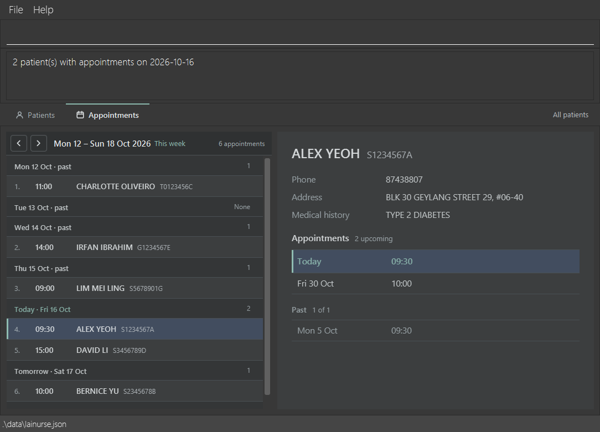

LaiNurse is a **desktop application that gives home nurses fast access to patient and appointment details for home visits, optimized for use through a Command Line Interface (CLI)** while retaining the benefits of a Graphical User Interface (GUI). If you type quickly, LaiNurse can help you look up and update patient details faster than traditional GUI applications.

* Table of Contents
{:toc}

--------------------------------------------------------------------------------------------------------------------

## Quick start

1. Ensure that Java `25` or later is installed on your computer.<br>
   **Mac users:** Ensure you have the precise JDK version prescribed [here](https://se-education.org/guides/tutorials/javaInstallationMac.html).

1. Download the latest `.jar` file from [here](https://github.com/AY2627S1-CS2103T-F08-2/tp/releases).

1. Copy the file to the folder you want to use as the _home folder_ for LaiNurse.

1. Open a terminal, `cd` to the folder containing the JAR file, and run `java -jar lainurse.jar`.<br>
   LaiNurse keeps its data in the folder you launch it from, so always launch it from this folder.<br>
   A GUI similar to the one below should appear in a few seconds. Note how the app contains some sample data.<br>
   

1. Type a command in the command box and press <kbd>Enter</kbd> to execute it. For example, type `help` to view the summary of all commands in the result display, type `help add` to see help specific to adding patients, or press <kbd>F1</kbd> / select **Help** > **Help** / `help window` to open the Help window with the full user guide.<br><br>

    Some example commands you can try:

   * `list` : Lists all patients.

   * `add --id T0123456B --name John Doe --phone 98765432 --address John street, block 123, #01-01` : Adds a patient named `John Doe` with the ID `T0123456B`.

   * `view S1234567A` : Shows the details of the patient with the ID `S1234567A` (Alex Yeoh, in the sample data).

   * `viewappt 2026-10-05` : Switches to the **Appointments** view, and shows only the appointments on October 5, 2026, with the first one selected.

   * `delete S1234567A` : Deletes the patient with the ID `S1234567A` (Alex Yeoh, in the sample data).

   * `exit` : Exits the app.

1. Refer to the [Features](#features) section below for details of each command.

--------------------------------------------------------------------------------------------------------------------

## Features

<div markdown="block" class="alert alert-info">

**:information_source: Notes about the command format:**<br>

* Words in `UPPER_CASE` are the parameters to be supplied by the user.<br>
  For example, in `add --name NAME`, replace `NAME` with a value such as `John Doe`.

* Items in square brackets are optional.<br>
  For example, `--name NAME [--medical-history MEDICAL_HISTORY]` can be used as `--name John Doe --medical-history Asthma` or as `--name John Doe`.

* Items followed by `…`​ can appear zero or more times.<br>
  For example, `[KEYWORD]…​` may be omitted, or written as `John` or `John Jane`.

* Options (words starting with `--`) can be in any order. A parameter that must come first, such as `ID` in `edit`, must stay first.<br>
  For example, if the command specifies `--name NAME --phone PHONE`, `--phone PHONE --name NAME` is also acceptable.

* Extraneous parameters for commands that take no parameters, such as `list`, `exit`, and `clear`, are ignored.<br>
  For example, `list 123` is interpreted as `list`.

* Keys such as Tab, Esc, and Up and Down save typing. See [Using the keyboard](#using-the-keyboard).

* If you are using a PDF version of this document, be careful when copying and pasting commands that span multiple lines as space characters surrounding line-breaks may be omitted when copied over to the application.
</div>

### The patient and appointment views

LaiNurse shows one view at a time. The tabs under the result display switch between them:

* **Patients**: the list of patients, each with their next appointment, and beside it the details of one patient.
  * A header above the list says whether it shows `All patients` or `Filtered patients`, such as after `find`, and how many: `12 patients`, or `3 of 12` when filtered. A filtered list also shows `Esc to show all patients`. An empty list says `No patients yet.` or `No patients match the filter.`
  * The next appointment of a patient is their first appointment that has not passed.
  * The details show the patient's notes under their medical history. They list every upcoming appointment of the patient, in time order, and their last ten past appointments, dimmed, each with its details beside its time, or under it in a narrow window.
* **Appointments**: the appointments, day by day, and beside them the details of the selected appointment's patient, with that appointment marked. If it is older than the patient's last ten past appointments, the details list it under **Past** as well. Each day has a heading with its number of appointments, and the appointments are numbered from 1 down the page. An appointment's details, if it has any, show under its patient's name.
  * An appointment with no time shows `‒‒:‒‒` in the list, and `No time specified` in the details. It comes first in its day, except today: there it comes after the appointments that have passed, right above the next one.
  * The appointments that have passed are greyed out.
  * The view has two kinds of page. The **weekly view** shows one week, from Monday to Sunday, with a heading for every day. Its header shows the dates, and `This week`, `Last week` or `Next week` when it is one of those. After [`viewappt`](#viewing-appointments-viewappt), the view shows only the appointments that it found, on one page, with a heading for each day that has one. Its header shows the dates, and `Esc to show the weekly view`.

In both views, the list and the details share the width of the window, and grow and shrink together as you resize it. In a small window, each takes about half. In a larger one, the details take more, up to 72% on a full HD screen.

An appointment has passed once its time today has gone by, or once its day is over if it has no time. So one at 10:00 has passed from 10:01. LaiNurse keeps up with the clock while it is left open: within a few seconds of an appointment passing, it is greyed out and moves under **Past**, and after midnight, the new day is marked as today. Orange marks what is today, such as today's heading and today's appointments. A blue marks what is selected, and what has the keyboard focus.



Commands switch the view. `viewappt` shows **Appointments**, and `list`, `find`, `view`, `add` and `edit` show **Patients**. Other commands, such as `delete`, `clear` and `help`, keep the view that is shown. You can also click a tab, or move to the tabs with the keyboard and press Left or Right. Switching views this way runs no command, so each view still shows what it showed before.

In the weekly view, click the arrow buttons above the list to see another week, or press Left or Right with the focus in the list. The arrows show only in the weekly view. Esc in the list goes back from a `viewappt` page to the weekly view, and from the weekly view to this week.

### Using the keyboard

You can use LaiNurse without the mouse. The keyboard focus is in the command box or in the view that is shown. In the view, it is on the view tabs or in the list below them, and Tab, Up and Down move between the two. Esc moves from the command box to the view, and typing or Enter moves back. The part with the focus has a blue border, and the command box is dimmed while the focus is elsewhere. The details beside the list do not take the focus. To scroll them, press Shift+Up and Shift+Down in the view, or use the mouse.

**In the command box:**

Key | What it does
--------|------------------
Enter | Runs the command.
Tab | Finishes typing a patient ID after `view`, `delete` or `edit`. See below. With nothing to finish, such as in an empty command box, it does nothing.
Up and Down | Go back and forth through the commands you entered since LaiNurse started, including ones that failed. Down after the newest command gives back what you were typing.
Esc | Moves to the list of the view that is shown, or to the tabs if the patient list is empty. What you typed stays in the command box.

**On the view tabs:**

Key | What it does
--------|------------------
Left and Right | Show the **Patients** or the **Appointments** view.
Down and Tab | Move to the list below the tabs.
Up | Does nothing, so the focus stays on the tabs.
Other keys | Work as they do in a list, below.

**In a list:**

Key | What it does
--------|------------------
Up and Down | In the patient list, select the previous or next patient and show their details. In the appointment list, select the previous or next appointment and show its patient's details. Up at the first patient, or at the first appointment of the page, moves to the view tabs.
Ctrl+Up and Ctrl+Down (Cmd+Up and Cmd+Down on macOS) | Select the first or last patient in the patient list, or the first or last appointment of the page in the appointment list.
Page Up, Page Down, Home and End | In the patient list, move further, in the same way as Up and Down. In the appointment list, select the first or last appointment of the page.
Left and Right | In the weekly appointment view, show the previous or next week, and select its first appointment. On a `viewappt` page, they do nothing.
Shift+Up and Shift+Down | Scroll the details beside the list.
Tab | Moves to the view tabs.
Any letter, digit or space | Goes back to the command box and types it there, after what you typed before.
Enter | Goes back to the command box, keeping what you typed.
Esc | In the patient view, shows all patients, as `list` does. In the appointment view, goes back from a `viewappt` page to the weekly view, and from the weekly view to this week.

* Shift+Tab does nothing, in the command box or in the view.
* The appointment list takes the focus even in a week with no appointments, so that Left and Right still work. Up there moves to the view tabs.
* When the focus moves to the patient list, the patient whose details are shown stays selected. If no patient in the list is selected, LaiNurse selects the first one and shows their details. So the selected patient is always the one shown.
* When the focus moves to the appointment list and no appointment is selected, LaiNurse selects the first appointment that has not passed, on a page that includes today, or the first appointment of another page, and shows its patient's details.
* For example, after `find --address serangoon`, press Esc to move to the results, then Down to look through them one by one. Press Esc again to see all patients, and start typing to enter the next command.
* To finish a patient ID with Tab, type the first few characters of the ID, or none, and press Tab to fill in the first ID that matches. Press Tab again to go through the other matches. Patients in the displayed list come first.<br>
  For example, if you type `view s12` and press Tab, LaiNurse fills in `view S1234567A`.<br>
  With `edit`, Tab also works after you have typed the options, and keeps them. For example, `edit s12 --phone 91234567` becomes `edit S1234567A --phone 91234567`.
* The command box supports the usual editing keys. For example, Shift+Left and Shift+Right select text, and Ctrl+C, Ctrl+X, Ctrl+V and Ctrl+A copy, cut, paste and select all (Cmd instead of Ctrl on macOS).

### Viewing help: `help`

Accesses in-app guidance through the command line or opens the full built-in User Guide window.

LaiNurse offers three ways to get help:

1. **Full User Guide Window** (<kbd>F1</kbd> / select **Help** > **Help** / `help window`): Opens a dedicated help
   window containing the complete, bundled User Guide for convenient browsing alongside your work, as well as a button to copy the link to the online guide.
2. **Command Overview** (`help`): Prints a concise list and summary of all available commands directly in the application's result display box.
3. **Targeted Command Help** (`help COMMAND` or `help --COMMAND`): Displays detailed usage rules, parameter formats, and examples for a specific command directly in the result display box.

Format: `help [COMMAND]` or `help [--COMMAND]`

* Typing `help` without arguments outputs a summary of all commands in the result display.
* Adding a command name or flag (e.g., `help add` or `help --add`, `help edit` or `help --edit`) displays the syntax and practical examples for that command.
* Typing `help window` or `help --window` opens the pop-up Help Window containing the complete User Guide.

Examples:
* `help` shows a quick summary list of all available commands in the result display.
* `help add` (or `help --add`) shows the exact parameters and examples for adding a patient.
* `help edit` (or `help --edit`) shows how to modify patient details and manage appointments.
* `help window` (or `help --window`) opens the full User Guide window.
* Pressing <kbd>F1</kbd> opens the full User Guide window.

### Adding a patient: `add`

Adds a patient to LaiNurse.

Format: `add --id ID --name NAME --phone PHONE --address ADDRESS [--medical-history MEDICAL_HISTORY] [--appt DATE_OR_DATETIME]…​`

* `--id`, `--name`, `--phone`, and `--address` are required. Each must have a non-blank value.
* Medical history and appointments are independently optional. If an option is supplied, its value must not be blank.
* Parameters may appear in any order. Each option may appear only once, except `--appt`, which can be repeated to add several appointments. Separate options and values using spaces or tabs; values may contain spaces.
* IDs contain 1 to 10 letters or digits. IDs are case-insensitive, and a patient with an existing ID cannot be added again.
* Names, addresses, and medical history accept any non-blank text. IDs and these text fields are stored in uppercase, with repeated whitespace collapsed.
* Phone numbers may contain digits, spaces, `+`, and `-`, and must contain at least three digits.
* Each appointment must be a real date in `yyyy-MM-dd` format, optionally followed by a 24-hour time in `HH:mm` format, such as `2026-11-30` or `2026-11-30 09:00`. Past dates are accepted. If the same appointment is given twice, it is kept once. A date-only appointment and a timed one on the same day, including `00:00`, are kept as separate appointments.
* Appointments have no time zone. They are the local date and time of the visit, as you would write them on a calendar, so changing your computer's time zone does not change them.
* Whitespace-delimited words beginning with `--` are reserved for options, including within text fields. Unknown options, misspellings, and `--name=value` syntax are rejected with the command usage instructions.
* After a patient is added, the list shows all patients again, even if it was showing `find` or `viewappt` results. The list numbers of other patients may change.

Examples:

* `add --id T0123456B --name John Doe --phone 98765432 --address John street, block 123, #01-01`
* `add --medical-history Asthma --address Block 312, Clementi Ave 2 --phone 91234567 --name Betsy Crowe --id S2222222B --appt 2026-11-30`
* `add --appt 2026-11-30 09:00 --name James Ho --id S3333333C --address 123, Clementi Rd, 1234665 --phone 22224444 --appt 2026-12-14 09:00`

### Listing all patients: `list`

Shows a list of all patients.

Format: `list`

* Each row shows the patient's list number, name and ID, and their next appointment if they have one. The next appointment is the earliest one today or later, so past appointments are not shown. A name too long for the row ends in `…`, and `view` shows it in full.
* To see a patient's phone number, address and medical history, use `view`, described below.
* Next appointments are shown relative to today: `Today 09:30`, `Tomorrow`, a weekday such as `Tue 14:00` within the next 6 days, and a date such as `30 Nov` or `5 Jan 2027` after that. Today's appointments are highlighted.

### Editing a patient: `edit`

Edits the details of an existing patient, and adds or removes their appointments.

Format: `edit ID [--name NAME] [--phone PHONE] [--address ADDRESS] [--medical-history MEDICAL_HISTORY] [--add-appt DATE_OR_DATETIME]…​ [--remove-appt DATE_OR_DATETIME]…​`

* Edits the patient with the given `ID`, which is the patient ID shown in their row, not their position in the list. The patient does not have to be in the list currently shown.
* `ID` must come first; the other parameters may appear in any order. Separate options and values using spaces or tabs.
* As in `add`, whitespace-delimited words beginning with `--` are reserved for options. Unknown options, misspellings, and `--id` are rejected with the command usage instructions.
* The ID itself cannot be edited. To correct a wrong ID, delete the patient and add them again.
* At least one of the optional parameters must be provided.
* `--name`, `--phone`, `--address`, and `--medical-history` replace the existing value. Each may appear only once, and follows the same rules as in [`add`](#adding-a-patient-add).
* `--add-appt` adds an appointment, and `--remove-appt` removes one. Both can be repeated. Appointments use the same format as in `add`.
* `--remove-appt` must match an existing appointment exactly. For example, `--remove-appt 2026-10-05` does not remove `2026-10-05 09:30`. If any appointment to remove is not found, nothing is changed.
* Appointments are removed before they are added, so one command can move an appointment to a new date. Adding an appointment the patient already has makes no change. As with `add`, a date-only appointment and a timed one on the same day are separate appointments.
* After a patient is edited, the list shows all patients again.

Examples:
*  `edit S1234567A --phone 91234567 --address Blk 30 Geylang Street 29, #06-41` changes the phone number and address of patient `S1234567A`.
*  `edit S1234567A --medical-history Type 2 diabetes, hypertension` replaces the medical history of patient `S1234567A`.
*  `edit S1234567A --add-appt 2026-12-01 10:00 --add-appt 2026-12-15` adds two appointments.
*  `edit S1234567A --remove-appt 2026-10-05 09:30 --add-appt 2026-10-07 14:00` moves an appointment from 5 October to 7 October.

### Locating patients by substrings: `find`

Finds patients whose specified fields contain any of the supplied substrings.

Format: `find [--id ID] [--name NAME] [--address ADDRESS] [--phone PHONE] [--medical-history HISTORY]`

* `find` searches patient details only. To search by appointment date, use [`viewappt`](#viewing-appointments-viewappt).

* Supply at least one option. Each supplied option must have a non-blank value and may appear only once.
* Parameters may appear in any order. Separate options and values using spaces or tabs; values may contain spaces.
* Values may be unquoted or enclosed in matching straight double quotes (`"Mary"`) or curly double quotes (`“Mary”`). Quotes must surround the complete value; missing or mismatched closing quotes and text after a closing quote are rejected.
* Matching ignores case and repeated whitespace. For example, `--name han` matches `Hans`, and `--address "marina   bay"` matches `Marina Bay`.
* Each value is one contiguous substring of its corresponding field. For example, `--address "Marina Bay"` matches that phrase, while `--address "Bay Marina"` does not match `Marina Bay`.
* Patients matching **any** supplied option are returned (an `OR` search). For example, `--name John --address "Marina Bay"` finds patients whose name contains `John` **or** whose address contains `Marina Bay`. Each patient appears once, in the original list order.
* Phone searches match the stored text, so partial values such as `--phone 123` are accepted. Phone punctuation remains significant: `9876-54` does not contain `987654`.
* Patients without medical history do not match a `--medical-history` search, but may match another supplied option.
* Whitespace-delimited words beginning with `--` are reserved for options, including within quoted values. Unknown options, misspellings, and `--name=value` syntax are rejected. Text such as `Anne--Marie` is accepted.
* Each search checks all patients, even when the list is already filtered. No matches produces an empty list and a count of zero. Invalid commands leave the displayed list unchanged. To see all patients again, enter `list`, or press Esc twice: once to move to the patient list, and once to show all patients.

Examples:

* `find --name "John" --address "Marina Bay"` finds patients whose name contains `John` or whose address contains `Marina Bay`.
* `find --id “T04”` finds patients whose ID contains `T04`.
* `find --id "123"` finds patients whose ID contains `123`.
* `find --medical-history penicillin --name tan` finds patients whose medical history contains `penicillin` or whose name contains `tan`.

### Viewing appointments: `viewappt`

Shows only the appointments on a date, or between two dates, in the appointment view, and lists the patients who have one.

Format: `viewappt DATE` or `viewappt [--from START_DATE] [--to END_DATE]`

* All dates must be real dates in `yyyy-MM-dd` format.
* `viewappt DATE` looks for appointments on `DATE`.
* With `--from` and `--to`, the range includes both dates. Give at least one of them, in any order, each at most once.
* Without `--from`, the range starts today. Without `--to`, the range has no end.
* "Today" is the current date on your computer, in its time zone. If your computer is set to a different time zone from where you visit patients, "today" can be a day off near midnight.
* The `--from` date must not be later than the `--to` date. With only `--to`, the date must not be before today. To see past appointments, give `--from` too.
* `DATE` cannot be combined with `--from` or `--to`.
* LaiNurse switches to the **Appointments** view, and shows the appointments in the range on one page, in place of the weekly view. The first one is selected, and its patient's details are shown. If no appointment is in the range, the page says `No appointments in this range.`
* To go back to the weekly view, press Esc with the focus in the appointment list. The weekly view shows the week that it showed before. See [The patient and appointment views](#the-patient-and-appointment-views).
* The patient list, on the **Patients** tab, shows the patients with an appointment in the range. All of each patient's appointments are checked, with or without a time. Each patient appears once, in the original list order. If no patient has an appointment in the range, the patient list is empty.
* Only dates are compared, so an appointment earlier today still counts.

Examples:
* `viewappt 2026-10-15` shows the appointments on October 15, 2026.
* `viewappt --from 2026-10-01 --to 2026-10-31` shows the appointments in October 2026.
* `viewappt --to 2026-10-31` shows the appointments from today to October 31, 2026.
* `viewappt --from 2026-12-01` shows the appointments on or after December 1, 2026.

### Viewing a patient's details: `view`

Shows all the details of a patient in the panel beside the patient list.

Format: `view ID`

* Shows the patient with the specified `ID`. IDs are case-insensitive, so `s1234567a` and `S1234567A` refer to the same patient.
* The patient does not need to be in the displayed list, because `view` searches all patients. If they are in the displayed list, their row is highlighted.
* If no patient has that ID, LaiNurse shows an error, and the panel keeps showing what it showed before.
* LaiNurse switches to the **Patients** view.
* The panel shows the patient's name, ID, phone number, address, medical history, notes and appointments, each appointment with its details. Under **Appointments**, it lists every appointment that has not passed, in time order. Under **Past**, it lists the last ten that have passed, latest first and dimmed, including any earlier today. An appointment today or tomorrow shows `Today` or `Tomorrow`, and one with no time shows `No time specified`. A patient with no appointment left shows `None upcoming`. If the details do not fit, press Shift+Down with the focus in the view, or scroll down the panel.
* The panel stays up to date. After you edit the patient, it shows the new details. After you delete the patient, or delete all patients with `clear`, it goes back to its starting message.
* You can also click a patient in the list to see their details, or press Esc and move to them with Up and Down. See [Using the keyboard](#using-the-keyboard).

Examples:
* `view S1234567A` shows the details of the patient with the ID `S1234567A`.

### Deleting a patient: `delete`

Deletes the specified patient from LaiNurse.

Format: `delete ID`

* Deletes the patient with the specified `ID`. IDs are case-insensitive, so `s1234567a` and `S1234567A` refer to the same patient.
* The patient does not need to be in the displayed list, because `delete` searches all patients.
* If no patient has that ID, LaiNurse shows an error and deletes nothing.
* The displayed list keeps its current filter, so the list numbers of the patients below the deleted one go down by one.

Examples:
* `delete S1234567A` deletes the patient with the ID `S1234567A`.

### Deleting all patients: `clear`

Deletes all patients from LaiNurse. This cannot be undone.

Format: `clear`

### Exiting the program: `exit`

Exits the program.

Format: `exit`

### Saving the data

LaiNurse saves your data automatically after every command that succeeds. You do not need to save manually.

### Editing the data file

LaiNurse saves its data as a JSON file, `data/lainurse.json`, inside the folder you launched it from. If you followed the [Quick start](#quick-start), that is the folder containing the JAR file. Advanced users are welcome to update data directly by editing that data file.

No command sets a patient's notes or an appointment's details yet, so for now you can add them only in the data file. A patient's `"notes"` go after their `"medicalHistory"`, and each appointment is an object with its `"dateTime"`, and its `"details"` if it has any. LaiNurse stores the text in upper case, as it does for other fields:

```json
"notes" : "HAS A DOG; RING THE BELL AND WAIT AT THE GATE",
"appointments" : [ {
  "dateTime" : "2026-10-05 09:30",
  "details" : "INSULIN REVIEW"
}, {
  "dateTime" : "2026-11-02"
} ]
```

A data file from an earlier version of LaiNurse, which saves each appointment as a plain string such as `"2026-10-05 09:30"`, still loads. LaiNurse saves it in the new form after the next command.

<div markdown="span" class="alert alert-warning">:exclamation: **Caution:**
If your changes make the data file invalid, LaiNurse starts with an empty patient list the next time it launches. The next command that succeeds, even `list` or `help`, then overwrites the invalid file with the empty list, and the data in it is lost. Back up the file before you edit it. If LaiNurse starts empty after an edit, close the window without running any command (the `exit` command also saves), and restore your backup.<br>
Furthermore, certain edits can cause LaiNurse to behave in unexpected ways (e.g., if a value entered is outside of the acceptable range). Therefore, edit the data file only if you are confident that you can update it correctly.
</div>

--------------------------------------------------------------------------------------------------------------------

## FAQ

**Q**: How do I transfer my data to another computer?<br>
**A**: Install LaiNurse on the other computer. Then copy `data/lainurse.json` from your old LaiNurse home folder into a `data` folder next to the JAR file on the new computer, replacing the file there if there is one.

--------------------------------------------------------------------------------------------------------------------

## Known issues

1. **When using multiple screens**, if you move the application to a secondary screen, and later switch to using only the primary screen, the GUI will open off-screen. The remedy is to delete the `preferences.json` file created by the application before running the application again.
2. **If you minimize the Help Window** and then run the `help window` command (or `help --window`, **Help** > **Help**,
   or the keyboard shortcut <kbd>F1</kbd>) again, the original Help Window will remain minimized, and no new Help Window will appear. The remedy is to manually restore the minimized Help Window.
3. **In a narrow window**, such as at the default size, the hint and the count in a list's header, such as `Esc to show all patients`, can be cut short. The remedy is to widen the window.

--------------------------------------------------------------------------------------------------------------------

## Command summary

Action | Format, Examples
--------|-----------------
**Add** | `add --id ID --name NAME --phone PHONE --address ADDRESS [--medical-history MEDICAL_HISTORY] [--appt DATE_OR_DATETIME]…​` <br> e.g., `add --id S3333333C --name James Ho --phone 22224444 --address 123, Clementi Rd, 1234665 --appt 2026-11-30 09:00`
**Clear** | `clear`
**Delete** | `delete ID`<br> e.g., `delete T0123456B`
**Edit** | `edit ID [--name NAME] [--phone PHONE] [--address ADDRESS] [--medical-history MEDICAL_HISTORY] [--add-appt DATE_OR_DATETIME]…​ [--remove-appt DATE_OR_DATETIME]…​`<br> e.g., `edit S1234567A --phone 91234567 --add-appt 2026-12-01 10:00`
**Find** | `find [--id ID] [--name NAME] [--address ADDRESS] [--phone PHONE] [--medical-history HISTORY]`<br> e.g., `find --name "John" --address "Marina Bay"` (matches either field; at least one option required)
**List** | `list`
**View** | `view ID`<br> e.g., `view S1234567A`
**ViewAppt** | `viewappt DATE` or `viewappt [--from START_DATE] [--to END_DATE]`<br> e.g., `viewappt 2026-10-15`, `viewappt --from 2026-10-01 --to 2026-10-31`
**Help** | `help [COMMAND]` (or `help [--COMMAND]`)<br> e.g., `help`, `help add` (or `help --add`), `help window` (or `help --window`)
**Exit** | `exit`
